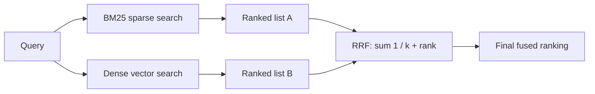

## Question
Why does pure dense-vector retrieval struggle with exact-keyword queries (such as product SKUs or error codes), and how does Reciprocal Rank Fusion (RRF) combine sparse search (BM25) with dense vector search mathematically?


## Quick Answer
Dense-vector retrieval struggles with SKUs and error codes because embeddings compress text into **semantic** representations that treat rare, precise tokens as noise; Reciprocal Rank Fusion fixes this by merging BM25's and the vector search's *rank positions* for each document into one combined score, rather than trying to reconcile their incompatible score scales directly.

## Detailed Answer
A dense embedding model is trained to place semantically similar text near each other in vector space — "cancel my order" and "I want a refund" end up close together even though they share almost no tokens. That's exactly the property that makes it bad at exact-match queries: a product SKU like `XJ-4471-B` or an error code like `ERR_CONN_RESET` carries almost no semantic meaning on its own. The embedding model has typically seen these tokens rarely (or split into odd sub-word pieces), so it has no strong signal for what makes one SKU different from another — two unrelated SKUs can end up nearly as close in vector space as the exact one you're searching for, because the model is optimizing for *meaning similarity*, not *string identity*.

**BM25** (sparse/keyword search) has the opposite strength: it scores documents by term frequency and inverse document frequency, so an exact token match on a rare string like a SKU produces a very high, very specific score — the rarer the term across the corpus, the more it counts. The problem is combining the two: BM25 scores and cosine-similarity scores live on entirely different, uncalibrated scales, so you can't just add them together meaningfully.

**Reciprocal Rank Fusion (RRF)** sidesteps the score-calibration problem entirely by ignoring the raw scores and using only each result's **rank position** in its own list:

```
RRF_score(d) = Σ  1 / (k + rank_i(d))
```

For each document `d`, you sum `1 / (k + rank)` across every ranked list it appears in (the BM25 list and the dense-vector list), where `rank_i(d)` is that document's position in list `i` (1st, 2nd, 3rd...) and `k` is a small constant (commonly 60) that dampens the influence of very high ranks so the fusion isn't dominated by whichever list happens to rank a niche result #1.



A document that ranks #1 in BM25 (exact SKU match) but doesn't appear in the dense list at all still gets a strong contribution from its BM25 rank alone, and a document ranking highly in both lists gets contributions from both — naturally rewarding results that either method independently considers strong, without needing to normalize scores across the two systems.

<Callout variant="tip" title="Key Takeaways">
RRF makes hybrid search possible without solving the harder problem of score normalization, by fusing on rank order — a scale every search method already shares.
</Callout>

---
