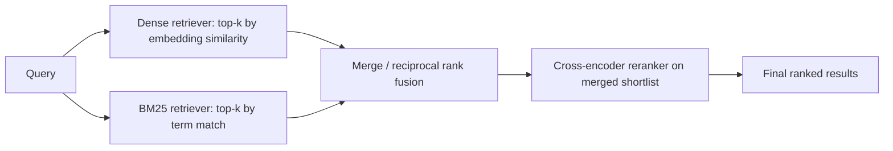

## Question
Why does pure dense-vector semantic search often underperform on queries involving exact terms (product SKUs, error codes, acronyms), and how does a hybrid retrieval architecture (dense + BM25/sparse, followed by a cross-encoder reranker) mitigate this without collapsing latency?

## Quick Answer
Dense embedding models are trained to capture semantic similarity, not exact surface tokens, so a rare identifier like a product SKU or error code doesn't stand out in embedding space the way it should. Hybrid search runs a lexical retriever (BM25/sparse) in parallel with the dense one and only pays the expensive reranking cost on the small merged shortlist, not the full index.

## Detailed Answer
A dense retriever's embedding model was trained on the statistical regularities of natural language — synonymy, paraphrase, topical closeness. That's exactly the wrong training signal for a token like `ERR-4021`: it's rare, it's often tokenized inconsistently by the model's subword tokenizer, and the embedding space has no strong reason to place `ERR-4021` and `ERR-4022` far apart, even though a user searching for one specifically does not want the other. The model has no concept of "these are different codes" — to it, they're two near-identical, low-frequency tokens sitting close together in a space optimized for meaning, not identity.

**BM25** (and sparse retrieval generally) is the opposite: it's a term-frequency-based ranking function with no notion of semantic meaning at all, but it excels at exactly this case — a document containing the literal string `ERR-4021` scores far higher than one that doesn't, because that's precisely what term-matching measures.

A **hybrid architecture** runs both retrievers independently against the same query and merges their results, so the system gets dense retrieval's strength on paraphrased or conceptual queries and BM25's strength on exact identifiers, SKUs, and acronyms, without having to guess in advance which kind of query it's handling.

The latency concern is real but avoidable: dense and BM25 retrieval run **in parallel**, not sequentially, so they don't add to each other's latency — the system waits for whichever is slower, not both combined. Their results are combined with a fusion method like reciprocal rank fusion (which merges rankings without needing directly comparable scores) into a single shortlist, typically tens of candidates rather than thousands.

Only that shortlist goes to the **cross-encoder reranker** — a model that jointly encodes the query and each candidate document together (rather than encoding them separately, like the dense retriever does) to produce a much more precise relevance score. Cross-encoders are far more accurate than embedding-similarity search but far too slow to run against an entire index; by construction, hybrid retrieval bounds the reranker's workload to a small, already-relevant candidate set, which is what keeps end-to-end latency from collapsing under the extra accuracy step.

<Callout variant="tip" title="Key Takeaways">
Don't ask a dense embedding to do a lexical retriever's job — run both in parallel and let a reranker spend its accuracy budget on a small merged shortlist instead of the whole index.
</Callout>

