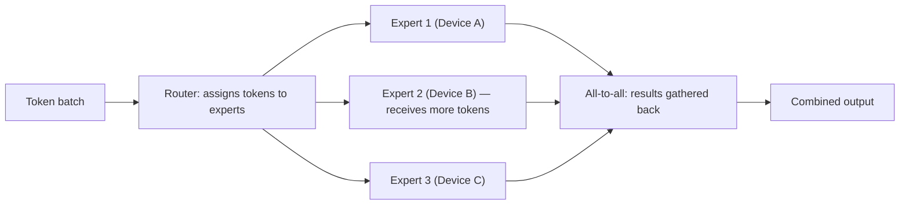

## Question
How does a Mixture-of-Experts (MoE) architecture achieve a larger effective parameter count without proportionally increasing inference compute, and what specific systems problems (routing imbalance, expert load skew, all-to-all communication overhead) does this introduce in distributed serving?

## Quick Answer
Mixture-of-Experts grows a model's **total** parameter count by adding many parallel expert networks, but keeps **per-token inference compute** roughly fixed because only a small top-k subset of experts activate for any given token — the cost of this trick shows up in distributed serving as routing imbalance, uneven expert load across devices, and expensive all-to-all communication when tokens need to reach experts living on different machines.

## Detailed Answer
A dense model's compute cost per token is tied directly to its total parameter count — every parameter does work for every token. MoE breaks this coupling: total capacity grows with the number and size of experts, but a token only activates k of the N available experts (e.g., 2 of 8), so compute per token scales with k, not N. This is what lets an MoE model have, say, 8x the parameter count of a comparably-fast dense model while running inference at roughly the dense model's speed — the "extra" parameters exist as *specialized* capacity that different tokens draw on differently, rather than uniform capacity every token pays for in full.

Serving this at scale reintroduces the complexity that the architecture hides during a single forward pass on one device. When experts are large enough that they're sharded across multiple GPUs or machines (**expert parallelism**), routing a token to its selected expert means **sending that token's activation over the network** to wherever that expert lives, running the expert's computation there, and sending the result back — this is fundamentally an **all-to-all communication** pattern, since any token in a batch could route to any expert on any device. All-to-all communication is expensive relative to the local matrix multiplications each expert performs, and it doesn't parallelize away the way compute does — network bandwidth between nodes is a much harder constraint than adding more compute.

**Routing imbalance and expert load skew** compound this: even with a well-trained load-balancing loss during training (see the related routing article), inference-time routing for any specific batch of *real* traffic can still be uneven — some topics or prompt types may naturally route more heavily to a subset of experts. If experts are distributed one-per-device, an imbalanced batch means some devices sit idle waiting for others that received a disproportionate share of tokens, which directly increases end-to-end latency for the whole batch, since the batch typically can't complete until the busiest expert finishes.

## Production Implications
- **Expert placement strategy** (how experts are assigned to devices) directly affects worst-case all-to-all communication cost — co-locating frequently co-activated experts on the same device can reduce cross-device traffic for common routing patterns.
- **Capacity factor** (a cap on how many tokens any single expert will process per batch, dropping or rerouting overflow) is a common mitigation for load skew, trading a small amount of routing accuracy for bounded worst-case latency.
- Monitoring **per-expert utilization in production traffic** (not just during training) catches drift where real-world traffic distribution differs from the training distribution the load-balancing loss was tuned against.
- Expert parallelism interacts with tensor and pipeline parallelism in large deployments — the communication topology needs to be co-designed, since naively layering all three parallelism strategies can create redundant or conflicting cross-device traffic.

<Callout variant="tip" title="Key Takeaways">
MoE's capacity-without-proportional-compute trick works cleanly in theory, but at serving scale it shifts the real bottleneck from raw compute to network communication and load balance across devices — problems that don't exist in a single-GPU forward pass but dominate at production scale.
</Callout>

