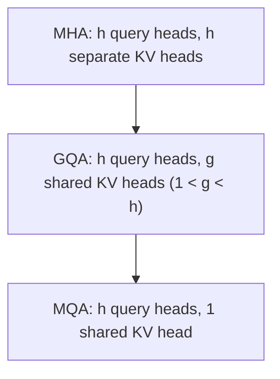

## Question
How do Multi-Query Attention (MQA) and Grouped-Query Attention (GQA) reduce KV cache memory pressure compared to standard Multi-Head Attention, and what quality trade-off is being accepted in exchange for that memory savings?

## Quick Answer
**Multi-Query Attention (MQA)** has every query head share a single, common key/value head, shrinking the KV cache by roughly a factor of the number of heads; **Grouped-Query Attention (GQA)** is a middle ground, sharing key/value heads across smaller groups of query heads rather than all of them — both reduce KV cache memory in exchange for less per-head representational diversity than standard Multi-Head Attention (MHA), where every query head has its own dedicated key/value head.

## Detailed Answer
In standard **Multi-Head Attention**, each of the h attention heads has its own independent Q, K, and V projections — meaning the KV cache must store h separate sets of keys and values per token, per layer. This gives each head maximum flexibility to specialize (different heads can learn to attend to different kinds of relationships), but it also means cache size scales linearly with the number of heads, which is a major contributor to the KV cache footprint discussed in memory-bandwidth-bound decoding.

**Multi-Query Attention** collapses this: all h query heads still exist and compute distinct query projections, but they all attend against a **single shared** key/value head instead of h separate ones. The KV cache now only needs to store one K and one V per token, per layer — a roughly h-fold reduction in cache size. The cost is that every query head is now attending against the *same* keys and values, losing the ability for different heads to develop genuinely distinct attention patterns over different key/value representations — in practice this can measurably hurt quality, especially on tasks that benefit from diverse attention patterns.

**Grouped-Query Attention** sits between the two: query heads are partitioned into **g groups** (where 1 < g < h), and each group shares one key/value head. This recovers some of the lost representational diversity — different groups can still specialize — while still shrinking the cache by a factor of h/g compared to full MHA. GQA is explicitly a tunable trade-off: g close to h approaches full MHA's quality and cache cost; g close to 1 approaches MQA's cache savings and quality cost.

| Variant | KV heads | Cache size vs. MHA | Quality vs. MHA |
|---------|----------|----------------------|-------------------|
| MHA (standard) | h (one per query head) | Baseline (largest) | Baseline (best per-head diversity) |
| GQA | g (shared across groups) | Reduced by factor h/g | Slight degradation, tunable via g |
| MQA | 1 (shared by all) | Reduced by factor h (largest reduction) | Largest degradation of the three |

## Production Implications
- GQA is now the default choice in most production LLMs specifically because it recovers most of MQA's cache savings while closing much of the quality gap to full MHA — g is typically chosen empirically per model size.
- Converting an already-trained MHA model to GQA/MQA (rather than training from scratch with it) requires a **head-merging / uptraining** step — averaging or fine-tuning the collapsed KV projections — since naively discarding heads degrades quality more than training with the reduced structure from the start.
- The cache savings compound directly with batch size and sequence length scaling discussed elsewhere — GQA/MQA's benefit grows, not shrinks, as concurrency and context length increase.
- Quality impact should be measured on tasks sensitive to fine-grained attention diversity (e.g., long-document retrieval, multi-hop reasoning), not just aggregate perplexity, since perplexity can mask localized degradation.

<Callout variant="tip" title="Key Takeaways">
MQA and GQA both shrink the KV cache by sharing key/value heads across query heads — GQA is the tunable middle ground that most production models land on because it keeps most of the memory win with less of the quality cost.
</Callout>

