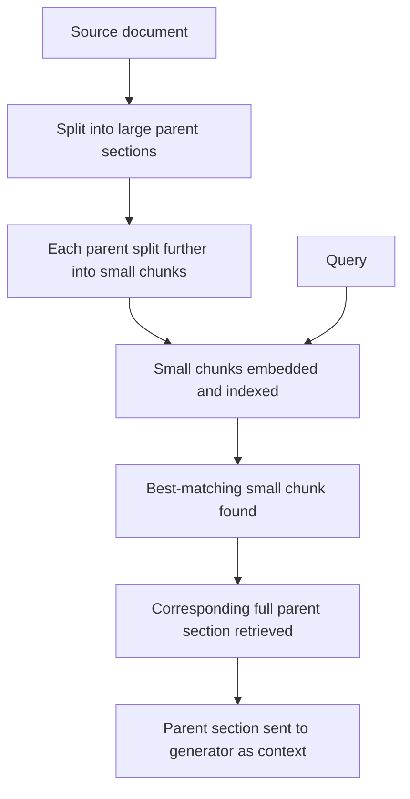

## Question
How does Parent Document / Small-to-Big Retrieval balance small chunk granular search precision with large context generation synthesis, and how does it prevent information fragmentation in RAG pipelines?

## Quick Answer
Parent Document Retrieval **searches over small chunks** for precise semantic matching, but **returns each matched chunk's larger parent context** to the generator model — decoupling the unit used for search from the unit used for synthesis so neither has to compromise the other.

## Detailed Answer
Chunk size in RAG creates a direct tension. Small chunks (a sentence or two) make similarity search more precise: embedding a short, focused passage produces a vector that closely matches a similarly focused query, without the noise of unrelated surrounding content diluting it. But small chunks are bad for generation — handing the language model a single isolated sentence often strips away the surrounding context it needs to answer correctly, or produces disjointed, **fragmented** context when several small chunks about the same topic get retrieved without the connective material between them.

Large chunks solve the fragmentation problem but reintroduce the search problem: embedding an entire multi-paragraph section compresses many distinct ideas into one vector, diluting the signal for whichever one topic the query actually cares about — a large chunk about "authentication" that also covers "rate limiting" and "logging" produces a blended embedding that may not score as the top match for a query specifically about authentication, even though the right answer is inside it.

**Parent Document Retrieval** (also called Small-to-Big Retrieval) resolves this by using two different granularities for two different jobs:

The **small chunks are what gets embedded and searched** — this is where precision matters, so the index optimizes for it. But the index also keeps a mapping from each small chunk back to the **larger parent section** it came from (a paragraph, a full document section, or the whole source document, depending on configuration). When a query matches a small chunk, the system doesn't hand that fragment to the generator — it looks up and returns the associated **parent**, giving the generation step the full surrounding context the precise match came from.

This directly prevents fragmentation: instead of stitching together several disconnected small chunks that all happen to mention the same topic, the generator receives one coherent, contiguous section per match — the actual passage the information lives in, not just the sentence that happened to score highest.

<Callout variant="tip" title="Key Takeaways">
Decoupling the retrieval granularity from the generation granularity lets each stage use the chunk size that's actually right for its job, instead of forcing one chunk size to serve both.
</Callout>

---
