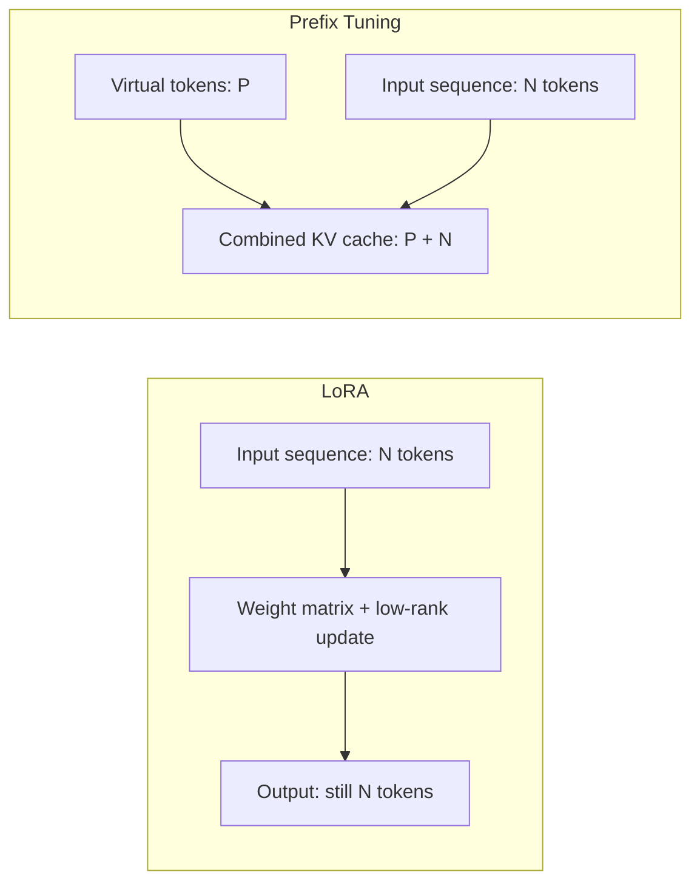

## Question
How does Prefix Tuning differ from LoRA in terms of parameter location and virtual token prepending, and why does Prefix Tuning decrease available effective context length and KV cache capacity during serving?

## Quick Answer
LoRA adds trainable low-rank matrices **inside the weight computation itself**, leaving the input sequence untouched; Prefix Tuning instead learns a set of **virtual tokens prepended to the input at every layer**, and because those virtual tokens occupy real positions in the sequence, they consume context length and KV cache space that LoRA never does.

## Detailed Answer
LoRA's trainable parameters live in **parameter space** — they modify how a weight matrix transforms whatever input arrives, but they add no new tokens to the sequence itself. A prompt of length 500 stays exactly length 500 whether or not LoRA adapters are attached; the adapters only change the arithmetic performed at each layer, not the shape of the sequence flowing through it.

Prefix Tuning's trainable parameters live in **activation space** instead. Rather than touching any weight matrix, it learns a fixed set of continuous "virtual token" vectors — not real vocabulary tokens, just trainable embeddings — and prepends them to the key and value activations at every transformer layer, as if a handful of extra (untokenizable) tokens sat at the front of every input. The model attends to these learned prefixes the same way it attends to real tokens, and that's precisely the mechanism by which task-specific behavior gets steered: the prefixes act like a persistent, learned instruction baked into every attention computation.

This difference in *where* the parameters live is exactly why it has a KV cache cost that LoRA doesn't:

During autoregressive generation, the **KV cache** stores the key and value tensors for every token in the sequence so they don't need to be recomputed at each new decoding step — its size scales directly with sequence length, and the model's effective context window is bounded by how much KV cache the serving hardware can hold. Because Prefix Tuning's virtual tokens are prepended as real entries in that same key/value sequence, every one of them consumes KV cache slots exactly like a real input token would — a prefix of length `P` reduces the model's effective usable context by `P` tokens, and permanently occupies `P` extra rows in the KV cache on every request, at every layer. LoRA's adapters, having added no tokens at all, leave the KV cache exactly as large as the base model's would be for the same input.

<Callout variant="tip" title="Key Takeaways">
Prefix Tuning's virtual tokens are real entries in the attention sequence and therefore real, permanent KV cache overhead; LoRA changes only the math inside each layer, so it costs nothing in context length or cache capacity.
</Callout>

---
