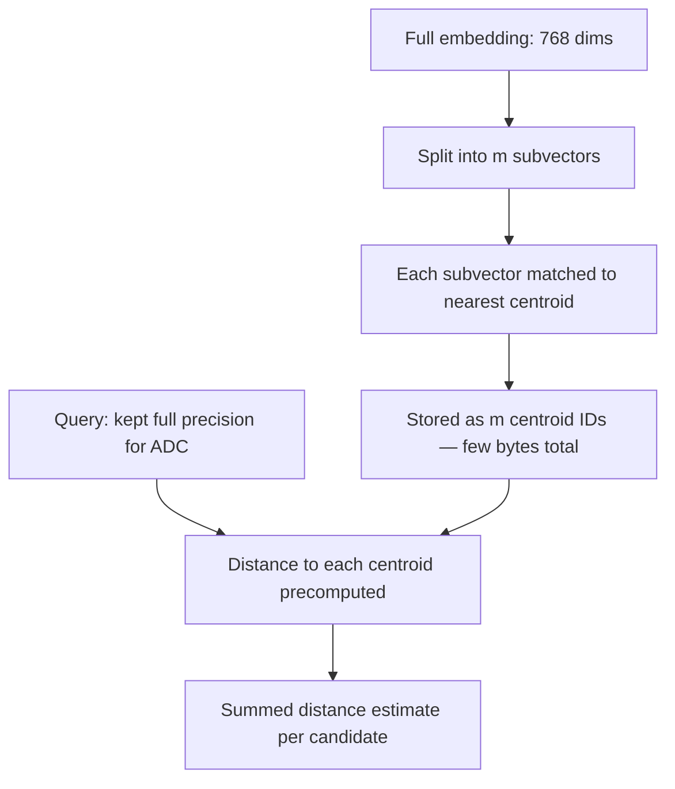

## Question
How does Product Quantization (PQ) compress high-dimensional vector embeddings into compact byte codes, and what is the difference between Symmetric Distance Computation (SDC) and Asymmetric Distance Computation (ADC) during vector retrieval?

## Quick Answer
Product Quantization (PQ) compresses a high-dimensional embedding by splitting it into smaller subvectors and replacing each one with the ID of its nearest **centroid** from a small learned codebook; **Asymmetric Distance Computation (ADC)** keeps the query vector uncompressed during search, giving noticeably better retrieval accuracy than **Symmetric Distance Computation (SDC)**, which compares two compressed codes instead.

## Detailed Answer
Storing full-precision embeddings for millions or billions of vectors is expensive — a 768-dimension FP32 embedding costs roughly 3KB per vector before any indexing overhead. PQ compresses this dramatically: it splits each embedding into `m` equal-length **subvectors** (e.g. splitting a 768-dim vector into 8 subvectors of 96 dimensions each), and for each subvector position, it runs a separate k-means clustering step over the training data to learn a small **codebook** of centroids (commonly 256 per subspace, representable in a single byte).

At encoding time, each subvector of a real embedding is replaced by the **ID of its nearest centroid** in that subspace's codebook — so a 768-dim, 3KB float vector might collapse into just 8 bytes (one byte per subvector, since 256 centroids fit in a `uint8`). This is a massive compression ratio, but it's lossy: two different original vectors that happen to land near the same centroid in every subspace become indistinguishable after compression.

Retrieval then needs a way to estimate distance using these compressed codes, and there are two approaches:

- **Symmetric Distance Computation (SDC)** compresses the *query* the same way as the stored vectors, then estimates distance by precomputed centroid-to-centroid distances between the query's code and each candidate's code. Both sides of the comparison are quantized, so the reconstruction error compounds — you're comparing two approximations of the truth against each other.
- **Asymmetric Distance Computation (ADC)** leaves the **query vector in full, uncompressed precision** and computes distance between the real query subvector and each candidate's centroid directly (precomputing a lookup table of distances from the query to every centroid in each subspace once per query, then summing). Only one side of the comparison carries quantization error instead of two, which is why ADC consistently retrieves more accurately than SDC at the same compression ratio.

<Callout variant="tip" title="Key Takeaways">
PQ trades retrieval precision for massive memory savings by replacing subvectors with centroid IDs, and ADC recovers most of that lost precision at search time simply by never compressing the query itself.
</Callout>

---
