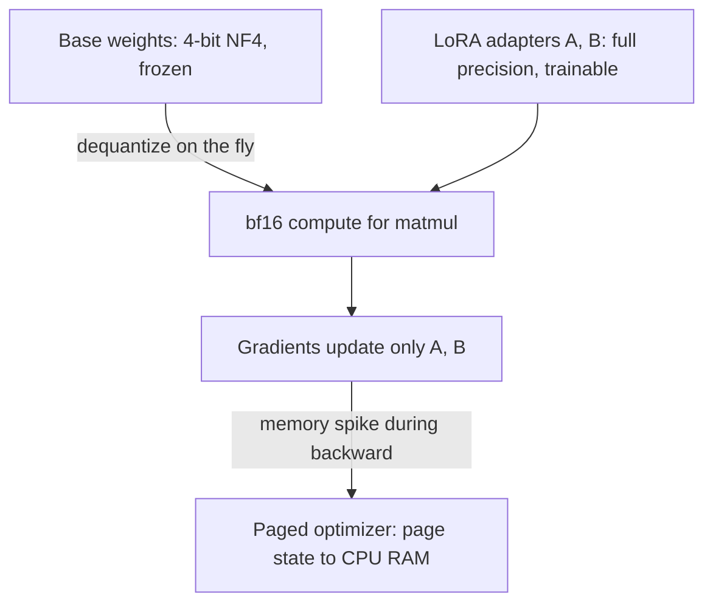

## Question
How does QLoRA combine 4-bit quantization of frozen base weights with full-precision LoRA adapters to make fine-tuning large models feasible on a single GPU, and what specific technique (e.g., double quantization, paged optimizers) is doing the heavy lifting to prevent memory spikes during training?

## Quick Answer
QLoRA stores the frozen base model's weights in 4-bit (NF4) precision to shrink its memory footprint, while the trainable LoRA adapter matrices stay in full precision — and it's **double quantization** plus **paged optimizers** specifically that keep training from spiking past available GPU memory.

## Detailed Answer
QLoRA's core idea is splitting precision by role: the frozen base weights only need to be read and dequantized for matrix multiplication, never updated, so they can tolerate aggressive compression. The trainable adapter matrices, by contrast, are actively receiving gradient updates, so they need the numerical stability of full (or near-full) precision to train correctly.

**4-bit NF4 (NormalFloat4)** quantizes the base weights to 4 bits per parameter — a data type specifically designed around the observation that pretrained weights are roughly normally distributed, so NF4's quantization levels are spaced to match that distribution rather than being evenly spaced like a naive integer quantization would be. Storage stays at 4 bits, but compute doesn't happen at 4 bits: weights are **dequantized on the fly** back to a higher-precision type (typically bf16) immediately before each matrix multiplication, then discarded again. This "quantized storage, higher-precision compute" split is what makes 4-bit storage compatible with numerically stable training at all.

The LoRA adapter matrices (`A` and `B`) are kept in full precision throughout, receiving normal gradient updates — they're a small fraction of total parameters, so keeping them at full precision costs little memory while giving the optimizer a numerically stable target to actually learn.

**The two techniques doing the heavy lifting on memory:**

- **Double quantization** — even 4-bit weights need per-block scaling constants to map quantized values back to real numbers, and storing those constants at full precision adds up across millions of blocks. Double quantization quantizes the quantization constants themselves, shaving roughly another 0.4 bits per parameter off the total footprint — a second, smaller compression pass applied to the overhead of the first one.
- **Paged optimizers** — training large models can produce transient memory spikes (for example, during gradient checkpointing on long sequences) that exceed available GPU memory even when the steady-state footprint fits comfortably. Paged optimizers use NVIDIA's unified memory to automatically page optimizer state between GPU and CPU memory when a spike occurs, rather than requiring the system to permanently reserve GPU memory for the worst-case peak. This is what prevents an out-of-memory crash from a spike that would otherwise be rare but fatal.

<Callout variant="tip" title="Key Takeaways">
QLoRA's memory savings come from compressing what doesn't need precision (frozen base weights, even down to their own scaling constants) while protecting what does (trainable adapters), with paged optimizers as the safety valve for the spikes that static memory budgeting would otherwise miss.
</Callout>

