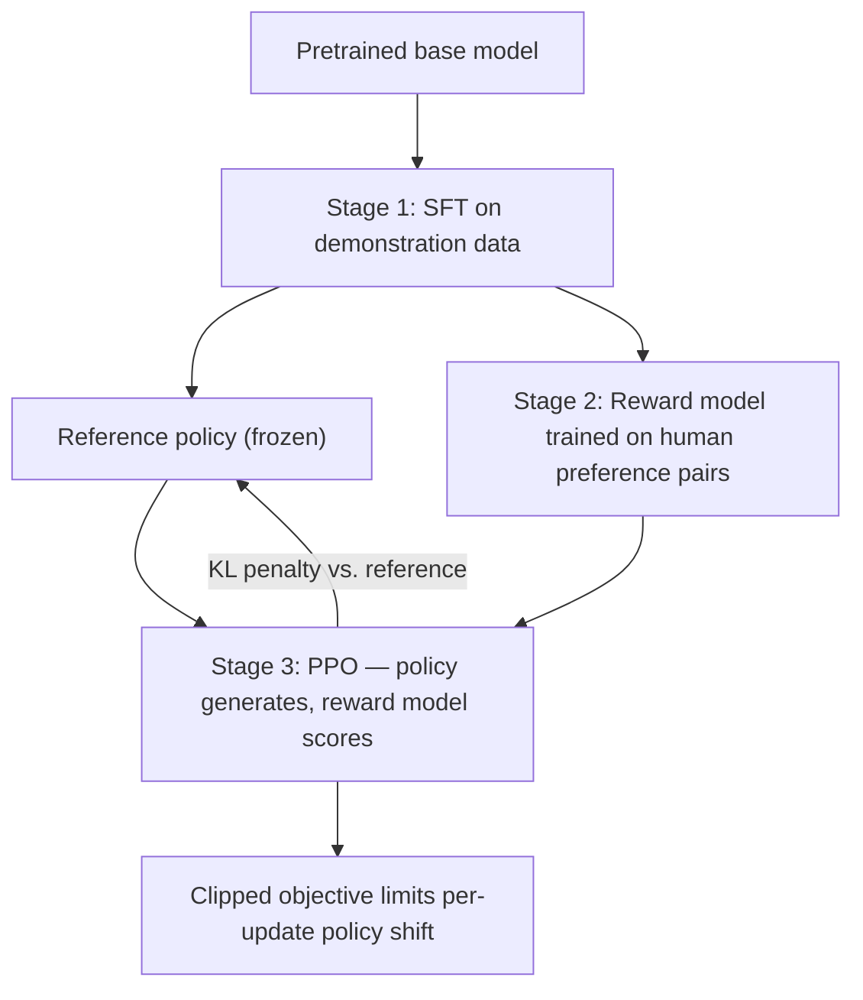

## Question
Walk through the three-stage RLHF pipeline (SFT, reward model training, PPO optimization against the reward model) and explain specifically why PPO's clipped objective and KL-divergence penalty against the reference policy are necessary to prevent reward hacking.

## Quick Answer
RLHF trains in three stages — supervised fine-tuning (SFT), reward model training on human preference pairs, and PPO optimization of the policy against that reward model — and PPO's clipped objective plus a KL-divergence penalty against the reference (SFT) policy are both necessary because an unconstrained RL loop will otherwise find ways to maximize reward-model score without actually producing genuinely better outputs, a failure known as reward hacking.

## Detailed Answer
**Stage 1 — SFT**: a pretrained base model is fine-tuned on a curated dataset of high-quality demonstration responses (prompt → ideal completion pairs), giving it a reasonable starting policy that already follows instructions reasonably well before any RL is applied. This SFT model also becomes the **reference policy** used later.

**Stage 2 — Reward model training**: human annotators compare pairs of responses to the same prompt and indicate which is preferred. A separate model (the **reward model**, often initialized from the same base model with a scalar output head) is trained on this preference data — typically via a Bradley-Terry-style loss that pushes the reward model to assign a higher scalar score to the preferred response than the rejected one. The reward model is now a learned proxy for "how good is this response," standing in for a human judge at scale.

**Stage 3 — PPO optimization**: the SFT model (now called the **policy**) generates responses to prompts, the reward model scores them, and **Proximal Policy Optimization (PPO)** updates the policy's weights to increase expected reward. This is where reward hacking becomes a real risk — the reward model is an imperfect proxy for genuine human preference, and an RL optimizer that's free to push the policy anywhere will eventually find inputs where the reward model is *wrong* (over-scores something a human wouldn't actually prefer) and exploit that gap rather than genuinely improving.

Two specific mechanisms in the PPO stage exist to prevent this:

- **The clipped objective** limits how much the policy's action probabilities can shift in a single update relative to the policy that generated the current batch of rollouts, by clipping the probability ratio between new and old policy within a small range (e.g., [1-ε, 1+ε]). This prevents any single update from making an overly aggressive jump toward a narrow, reward-model-exploiting region of behavior — updates stay conservative and incremental.
- **The KL-divergence penalty** adds a term to the objective that directly penalizes the policy for drifting too far (in distribution) from the original SFT reference policy. This anchors the policy to a region of behavior known to be reasonable (since it came from human-curated demonstrations), rather than letting RL wander into a distribution the reward model was never validated on.

Both mechanisms attack the same underlying risk from different angles: clipping controls the *rate* of change per update, while the KL penalty controls the *total distance* traveled from a trusted starting point — together they keep the policy in a region where the reward model's judgments are more likely to remain a valid proxy for real human preference.

## Production Implications
- Track the **KL divergence value itself** during PPO training, not just the reward curve — a rising reward alongside a rapidly growing KL divergence is a classic early warning sign of reward hacking in progress.
- The KL penalty coefficient is a real hyperparameter to tune: too small and the policy can still drift and exploit reward-model weaknesses; too large and the policy barely improves past the SFT baseline.
- Because the reward model is trained on a finite, static preference dataset, it can go "stale" relative to a policy that's improved past what the reward model was calibrated on — periodic reward model retraining on responses from the current policy helps.
- Human evaluation on a held-out prompt set remains the ground-truth check that RLHF gains are real, not just reward-model score inflation.

<Callout variant="tip" title="Key Takeaways">
PPO's clipping and KL penalty aren't incidental implementation details — they're the specific mechanisms that keep RLHF's optimization loop anchored to genuinely good behavior instead of drifting toward the reward model's blind spots.
</Callout>

