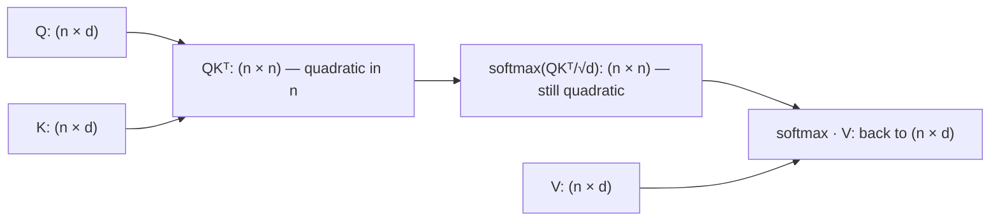

## Question
Derive why standard self-attention has O(n²) time and memory complexity with respect to sequence length, and explain precisely which intermediate tensor is responsible for the quadratic memory blowup during both training and naive inference.

## Quick Answer
Self-attention is O(n²) because every one of **n** query tokens must be compared against every one of **n** key tokens to compute attention scores, producing an **n × n** attention score matrix — that matrix (not the Q, K, or V projections, which are only O(n·d)) is the tensor responsible for the quadratic memory blowup.

## Detailed Answer
Self-attention computes, for a sequence of length **n** with hidden dimension **d**: `Attention(Q, K, V) = softmax(QKᵀ / √d) V`. Break this down by tensor:

- **Q, K, V projections**: each is a linear transform of the input, shaped `(n, d)`. Memory here scales as **O(n·d)** — linear in sequence length.
- **QKᵀ (the attention score matrix)**: this is where the quadratic term appears. Q is `(n, d)` and Kᵀ is `(d, n)`, so their product is `(n, n)` — every one of the n queries produces a score against every one of the n keys. This matrix has **n² entries**, independent of d, and it must be materialized (fully computed and typically stored) before the softmax normalization can be applied row-wise. That's the **O(n²)** memory tensor.
- **Softmax(QKᵀ/√d)**: same `(n, n)` shape, same O(n²) footprint — it's a row-wise normalization of the same matrix.
- **Output = softmax(...) · V**: the final matmul brings the shape back down to `(n, d)`, but only after the `(n, n)` intermediate has already been computed and (in a naive implementation) stored.

The **time complexity** is O(n²·d): computing every one of the n² entries in QKᵀ requires a dot product over d dimensions. The **memory complexity** is O(n²) for the attention matrix itself (plus O(n·d) for everything else, which is dominated by the n² term as sequence length grows) — this is the practical bottleneck, since GPU high-bandwidth memory (HBM) fills up with these n×n matrices long before compute becomes the limiting factor for large n.

This applies during **training** because backpropagation needs to keep the softmax output (or recompute it) to compute gradients through the attention weights — the same n² matrix has to exist in memory (or be recomputed) during the backward pass. It applies during **naive inference** too: even without gradients, a straightforward implementation computes and holds the full n×n score matrix for each forward pass, so a 10x longer prompt costs roughly 100x the attention-matrix memory, not 10x.

## Production Implications
- Doubling context length roughly **quadruples** attention-matrix memory and compute — this is precisely why long-context serving is disproportionately expensive compared to what a linear cost model would suggest.
- Techniques like FlashAttention don't eliminate the O(n²) *computation*, they eliminate the need to *materialize* the full n×n matrix in HBM at once — tiling computes it in blocks and never stores the whole thing (see the related FlashAttention article).
- Sliding Window Attention and other sparse-attention variants attack this differently — by shrinking the *effective* n each token attends to, turning the per-token cost back toward linear.
- When profiling attention layers, distinguish "compute-bound" (FLOPs are the bottleneck) from "memory-bound" (HBM read/write of the n×n matrix is the bottleneck) — the fix differs depending on which one dominates at your sequence length and hardware.

<Callout variant="tip" title="Key Takeaways">
The quadratic cost of self-attention lives entirely in the n×n score matrix produced by QKᵀ — every optimization strategy (windowing, sparsity, tiling) is ultimately an attack on that one tensor.
</Callout>

