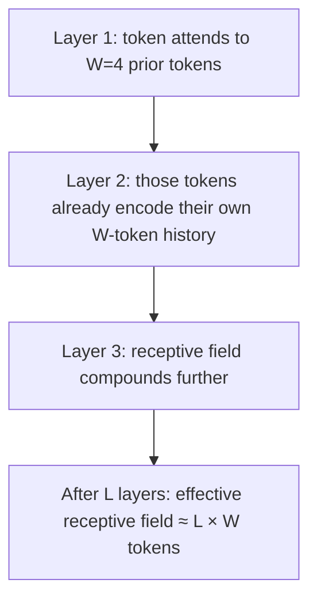

## Question
How does Sliding Window Attention (SWA) bound the KV Cache memory footprint to a fixed window size $W$, and how can hidden states in layer $L$ still retain a theoretical receptive field of $L \times W$ tokens?

## Quick Answer
Sliding Window Attention (SWA) restricts each token to attend only to the previous **W** tokens, so the KV cache never grows past a fixed window regardless of total sequence length — yet because each layer's output already encodes its own window of context, stacking **L** layers lets information effectively propagate back **L × W** tokens.

## Detailed Answer
Standard causal self-attention lets token *t* attend to all *t* prior tokens, so the KV cache grows linearly with sequence length — at 100K tokens, that's 100K key/value pairs per layer, per head. **Sliding Window Attention**, used in Mistral-style architectures, caps this: token *t* only attends to tokens in the range `[t - W + 1, t]`. Once a token falls outside the window, its key/value entries can be evicted from the cache, so the cache footprint is bounded at **O(W)** — constant with respect to total sequence length.

The subtlety is how the model still "sees" far-back context despite each individual attention operation being local. Think of it like a bucket brigade passing water: **at layer 1**, a token's hidden state already summarizes information from the W tokens directly behind it. **At layer 2**, when that token attends within its window, the tokens it attends to *already carry* summaries from *their* own windows one layer down — so the effective receptive field compounds across depth. After L layers, a token's hidden state has, in principle, absorbed information originating up to `L × W` tokens back, even though no single attention operation ever looked further than W tokens.

This is a genuinely different mechanism from full attention's direct token-to-token connections — it's an indirect, layer-by-layer relay rather than a single hop. That means very distant dependencies take more layers to surface (and can degrade if intermediate layers compress information lossily), which is the real trade-off being made in exchange for the fixed-memory cache.

## Production Implications
- Choosing **W** is a direct trade-off between KV cache memory and how many layers are needed before long-range dependencies surface — too small a W on a shallow model can silently truncate context the prompt actually needs.
- Some implementations interleave a handful of **full-attention layers** among sliding-window layers specifically to shortcut the layer-by-layer relay for tasks needing precise long-range recall (e.g., needle-in-haystack retrieval).
- Cache eviction policy matters: naive FIFO eviction of the oldest tokens is standard, but it means information that fell out of the window is only reachable through the compounded-layer path, not directly.
- Benchmark retrieval-style tasks (not just perplexity) when tuning W — perplexity can look fine even when literal long-range retrieval degrades, because the compounded receptive field is lossy in practice.

<Callout variant="tip" title="Key Takeaways">
Sliding Window Attention trades a single, direct long-range attention hop for many short, cheap ones — memory stays flat, but distant context now has to travel through the network's depth rather than through a single attention lookup.
</Callout>

