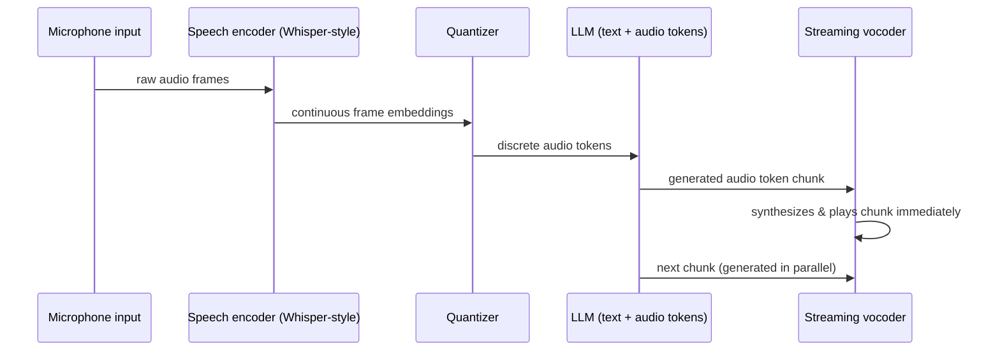

## Question
How do end-to-end speech-to-speech multimodal models align continuous frame-level audio features from a speech encoder (e.g., Whisper) with discrete LLM target tokens, and how is streaming latency minimized during speech synthesis?

## Quick Answer
End-to-end speech-to-speech models bridge continuous audio features and discrete LLM tokens by running a speech encoder (like Whisper's) followed by a **quantization step** that maps frame-level embeddings onto a fixed vocabulary of discrete audio tokens, letting the LLM predict speech tokens the same way it predicts text tokens — and latency is minimized by generating and vocoding audio in small streaming chunks rather than waiting for the full response.

## Detailed Answer
A speech encoder like Whisper produces **continuous, frame-level embeddings** — a dense vector every ~20ms of audio. An LLM, however, operates on a **discrete vocabulary** of tokens with a softmax over a fixed set of IDs; it has no native way to predict a continuous vector. Bridging this gap requires converting the continuous audio representation into a discrete sequence, typically via a **vector-quantization (VQ) codec** — trained separately (or jointly) to map each audio frame's embedding to the nearest of a fixed codebook of discrete "audio tokens." Once audio is represented this way, it can be interleaved with text tokens in the same sequence, and the LLM is trained autoregressively over the combined vocabulary — predicting the next token whether it happens to be text or audio.

On the output side, generating speech means the LLM predicts a sequence of audio tokens, which then get passed to a **vocoder** (a neural audio decoder) that reconstructs a waveform from the discrete tokens. The naive approach — generate the entire token sequence, then vocode the whole thing — adds the full generation time as latency before any sound plays, which is unacceptable for real-time conversation.

**Streaming synthesis** solves this by chunking the pipeline: as soon as a small window of audio tokens (e.g., a few hundred milliseconds worth) has been generated, that chunk is immediately sent to the vocoder and starts playing, while the LLM continues generating the next chunk in parallel. This requires the vocoder to support **causal / streaming-compatible synthesis** (only looking at past and current chunk context, not future audio) so it doesn't need to wait for tokens that haven't been generated yet.

## Production Implications
- The **quantization codec's granularity** (codebook size, frame rate) directly trades off audio fidelity against sequence length — finer codecs mean longer token sequences and more LLM compute per second of audio.
- Chunk size is a latency/quality knob: smaller chunks reduce time-to-first-audio but risk audible artifacts at chunk boundaries if the vocoder isn't well-conditioned on prior context.
- Interruption handling ("barge-in") requires the streaming pipeline to support mid-generation cancellation — a naive full-sequence generate-then-vocode design can't be interrupted gracefully.
- Measure **time-to-first-audio-byte**, not just total generation time, as the primary latency metric for conversational use cases.

<Callout variant="tip" title="Key Takeaways">
Discretizing audio into LLM-compatible tokens is what unifies speech and text in one model, and chunked streaming synthesis is what makes that unified model feel conversational rather than laggy.
</Callout>

