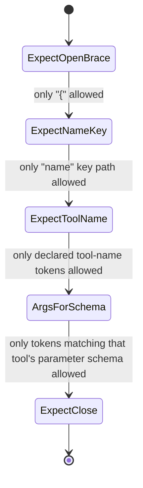

## Question
When forcing a model to execute a specific tool (e.g., `tool_choice: "required"`), how does the runtime engine enforce token masking on the initial generated tokens to guarantee a valid function header before parsing parameters?

## Quick Answer
Forcing a tool call works through **constrained decoding**: at every generation step, the runtime computes the set of tokens that are still valid under a grammar derived from the tool schemas, and sets the logits of every other token to negative infinity before sampling — the model is never actually free to emit something invalid.

## Detailed Answer
`tool_choice: "required"` can't be enforced after the fact by checking the model's output, because by the time an invalid function name has been generated it's already too late — the runtime has to prevent the wrong token from ever being sampled in the first place. This is done with **logit masking** driven by a grammar, not by instruction-following alone.

Before generation starts, the runtime compiles the available tool schemas into a **finite-state grammar** (conceptually, a JSON-schema-aware automaton): a structure describing every valid character sequence that could follow at each position — an opening brace, a `"name"` key, one of the enum values matching an actual tool name, a closing quote, and so on. At each decoding step, the engine intersects the model's full vocabulary against the set of tokens the current grammar state allows, and masks (sets to `-inf`) every logit outside that set before applying softmax or top-k/top-p sampling.

For the very first tokens — the ones that determine *which function* gets called — the grammar's start state only permits tokens that are valid prefixes of `{"name": "<one of the declared tool names>"...`. This is what guarantees a syntactically valid function header: the model literally cannot sample a token that would produce a made-up function name or malformed JSON, because that token's probability was forced to zero regardless of what the model's own distribution said.

Once the function name is resolved, the grammar's active state switches to that specific tool's **parameter schema** — so argument generation is constrained the same way: string fields only allow quoted-string-shaped tokens, enum fields only allow the declared values, numeric fields only allow digit/decimal-shaped tokens. This is why the parser downstream can assume well-formed JSON matching the declared schema rather than needing a lenient, error-tolerant parse step — the invalid paths were never reachable during generation.

<Callout variant="tip" title="Key Takeaways">
`tool_choice: "required"` isn't the model being well-behaved — it's the decoding loop refusing to let any token outside the tool grammar have nonzero probability, which is what turns "please call a function" into a hard guarantee.
</Callout>

