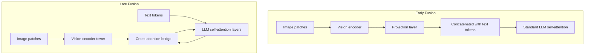

## Question
In a typical vision-language model architecture, how do image patch embeddings from a vision encoder get aligned into the same representational space as text token embeddings, and what are the engineering trade-offs between early fusion (joint embedding space) and late fusion (cross-attention bridging separate towers)?

## Quick Answer
Image patches from a vision encoder are turned into embeddings that a language model can consume either by **projecting them directly into the same token embedding space as text** (early fusion — they become "tokens" the LLM attends to like any other) or by **keeping vision processed in a separate tower** and letting the LLM access it through dedicated **cross-attention layers** (late fusion) — early fusion is simpler to train end-to-end but couples the two modalities tightly, while late fusion adds architectural complexity but lets each modality's encoder specialize more independently.

## Detailed Answer
A vision encoder (e.g., a ViT-style patch encoder) splits an image into fixed-size patches and produces one embedding vector per patch — conceptually similar to how a tokenizer produces one embedding per text token, except the vision embeddings live in whatever representational space the vision encoder was trained in, which isn't automatically the same space the language model's text embeddings live in.

**Early fusion** bridges this gap with a lightweight **projection layer** (often just a small MLP or linear layer) that maps each patch embedding into the LLM's token embedding dimensionality and space. Once projected, these vision "tokens" are simply concatenated into the input sequence alongside text tokens, and the LLM's existing self-attention layers handle all cross-modal interaction the same way they handle any other token-to-token attention — there's no architectural distinction between a vision token and a text token from the LLM's perspective. This is architecturally simple (no new layer types needed) and lets the LLM's attention mechanism learn arbitrary interactions between image and text content, but it does mean every vision token consumes a slot in the LLM's context window and gets the full quadratic attention cost of any other token.

**Late fusion** instead keeps a separate vision tower producing its own embeddings, and introduces **dedicated cross-attention layers** interleaved within (or after) the LLM's own layers — these layers let text token representations attend into the vision tower's output without vision tokens ever occupying slots in the LLM's primary self-attention sequence. The two towers can be trained with more independence (or even frozen separately and only the cross-attention bridge trained), and the vision representation doesn't inflate the effective sequence length the LLM's self-attention has to process — but this requires designing and training new architectural components (the cross-attention bridge) rather than reusing the LLM's existing layers unchanged.

| Aspect | Early fusion (joint embedding space) | Late fusion (cross-attention bridging) |
|--------|----------------------------------------|-------------------------------------------|
| Architecture | Reuses existing LLM self-attention | Requires new cross-attention layers |
| Context window cost | Vision tokens consume LLM sequence slots | Vision representation processed separately |
| Modality interaction | Learned implicitly via shared attention | Explicit, dedicated bridging layers |
| Training flexibility | Easier end-to-end joint training | Enables more independent tower training/freezing |
| Compute scaling with image count/resolution | Directly inflates LLM's O(n²) attention cost | More decoupled from LLM's core sequence cost |

## Production Implications
- Early fusion architectures need explicit **token budgeting** for images (how many patch tokens per image resolution) since every vision token directly competes with text tokens for context window space and attention compute.
- Late fusion architectures add inference-time complexity (an extra bridging component to serve and optimize) but can be more efficient for high-resolution images or multiple images per prompt, since vision tokens don't inflate the LLM's own sequence length.
- Freezing the vision encoder and only training the projection layer (early fusion) or cross-attention bridge (late fusion) is a common cost-saving strategy — but late fusion's architectural separation tends to make this partial-freezing strategy more natural to reason about.
- Evaluate fine-grained visual grounding tasks (e.g., "what's in the top-left corner") specifically, since both approaches can silently degrade spatial precision differently depending on patch tokenization and how cross-modal attention is structured.

<Callout variant="tip" title="Key Takeaways">
Early fusion buys architectural simplicity by treating vision tokens exactly like text tokens; late fusion buys efficiency and modularity by keeping vision genuinely separate and bridging it in deliberately — the right choice depends on whether context-window cost or architectural complexity is the bigger constraint.
</Callout>

