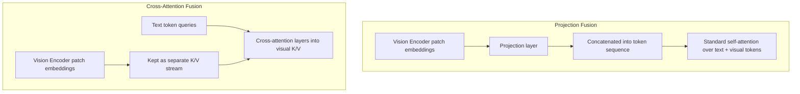

## Question
In vision-language models (e.g., LLaVA or Flamingo), how are continuous visual representations mapped into the textual embedding space, and what are the trade-offs between projection-layer architectures versus cross-attention fusion mechanisms?

## Quick Answer
Vision-language models fuse modalities either by **projecting** visual patch embeddings into the same vector space as text tokens so the language model treats them as ordinary input tokens (as in LLaVA-style architectures), or by keeping the two towers separate and letting text tokens **cross-attend** into visual features at each layer (as in Flamingo-style architectures) — the first is simpler and cheaper, the second scales better to many images per prompt.

## Detailed Answer
Both approaches start the same way: an image is split into patches and run through a **vision encoder** (typically a Vision Transformer) to produce a sequence of patch embeddings. The architectural fork happens in how those embeddings reach the language model.

**Projection-layer fusion** passes the vision encoder's output through a small trainable projection module (often just one or two linear layers, sometimes with a lightweight resampler) that maps visual embedding dimensions into the language model's token embedding dimension. The resulting vectors are then **concatenated directly into the input sequence** alongside text token embeddings — the language model's existing self-attention mechanism handles the rest, attending across text and visual tokens exactly as it would across any other tokens. This is architecturally minimal: the base language model's weights and attention mechanism are untouched, and only the projection layer (plus optionally the vision encoder) needs training. The cost is that every image consumes real sequence-length budget — a single image can expand into hundreds of visual tokens, competing directly with the text context window and inflating the KV cache during generation.

**Cross-attention fusion** keeps text and vision as separate representational streams. Instead of injecting visual tokens into the main sequence, dedicated **cross-attention layers** are interleaved into the language model's stack, where text tokens (as queries) attend directly into the vision encoder's output (as keys and values) at each of these layers. The visual features never enter the main token sequence, so they don't consume context-window budget the way projected tokens do, and a single set of visual features can be efficiently reused across many cross-attention layers without re-encoding. The trade-off is architectural complexity: the base language model needs new layers inserted and trained, and the design scales less transparently when the number of images per prompt grows very large, since each cross-attention layer's cost still scales with total visual token count.

<Callout variant="tip" title="Key Takeaways">
Projection fusion is simpler to train and reasons about images like text tokens, but eats directly into your context window — cross-attention fusion protects the context budget at the cost of a more invasive architecture.
</Callout>

---
