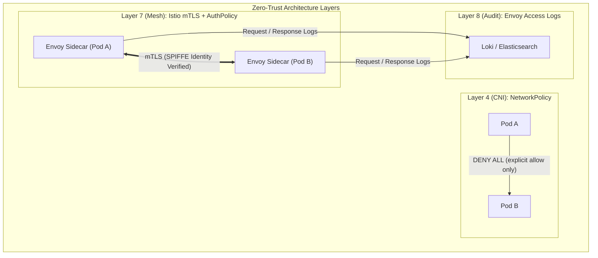

**Prerequisite knowledge:** Kubernetes networking model, CNI basics, TCP/IP fundamentals, Services

---

## Question
Your platform team must implement zero-trust networking for a financial services application. Requirements: all inter-service communication must be mutually authenticated and encrypted, no pod should communicate with any other pod unless explicitly allowed, east-west traffic must be auditable, and the solution must not require application code changes. Design and implement this.


## Quick Answer
Deploy **Istio** as your service mesh for automatic mTLS between all services, implement **NetworkPolicies** as the CNI-layer deny-all baseline, use **Istio AuthorizationPolicies** for fine-grained L7 access control, and enable **Envoy access logging** to a centralized store for audit trails. This gives you zero-trust without any application code changes.

---


## Detailed Answer
## ️ Zero-Trust Architecture Overview


## ️ Implementation: Layer by Layer
*Layer 1: NetworkPolicy — Deny All at CNI Level*
```yaml
# Step 1: Deploy a CNI that supports NetworkPolicy
# Calico, Cilium, or Weave Net (NOT Flannel — it doesn't enforce NetworkPolicy)

# Install Cilium (recommended — best performance and observability)
helm repo add cilium https://helm.cilium.io/
helm install cilium cilium/cilium \
  --namespace kube-system \
  --set kubeProxyReplacement=strict \
  --set hubble.enabled=true \
  --set hubble.relay.enabled=true \
  --set hubble.ui.enabled=true

# Verify Cilium is running
cilium status
cilium connectivity test
```

```yaml
# Step 2: Global deny-all NetworkPolicy (apply to every namespace)
# This is the zero-trust baseline — nothing talks to anything by default
apiVersion: networking.k8s.io/v1
kind: NetworkPolicy
metadata:
  name: default-deny-all
  namespace: production
spec:
  podSelector: {}      # Applies to ALL pods in namespace
  policyTypes:
    - Ingress
    - Egress
  # No ingress or egress rules = deny everything
---
# Allow DNS egress (required for service discovery — easy to forget!)
apiVersion: networking.k8s.io/v1
kind: NetworkPolicy
metadata:
  name: allow-dns-egress
  namespace: production
spec:
  podSelector: {}      # All pods need DNS
  policyTypes:
    - Egress
  egress:
    - ports:
        - port: 53
          protocol: UDP
        - port: 53
          protocol: TCP
      to:
        - namespaceSelector:
            matchLabels:
              kubernetes.io/metadata.name: kube-system
          podSelector:
            matchLabels:
              k8s-app: kube-dns
---
# Allow monitoring egress (Prometheus scraping)
apiVersion: networking.k8s.io/v1
kind: NetworkPolicy
metadata:
  name: allow-prometheus-scrape
  namespace: production
spec:
  podSelector: {}
  policyTypes:
    - Ingress
  ingress:
    - from:
        - namespaceSelector:
            matchLabels:
              kubernetes.io/metadata.name: monitoring
          podSelector:
            matchLabels:
              app: prometheus
      ports:
        - port: 9090
          protocol: TCP
```

```yaml
# Step 3: Service-specific allow rules
# Frontend → Backend API only
apiVersion: networking.k8s.io/v1
kind: NetworkPolicy
metadata:
  name: allow-frontend-to-backend
  namespace: production
spec:
  podSelector:
    matchLabels:
      app: backend-api        # This policy applies TO backend pods
  policyTypes:
    - Ingress
  ingress:
    - from:
        - podSelector:
            matchLabels:
              app: frontend   # Only allow traffic FROM frontend pods
      ports:
        - port: 8080
          protocol: TCP
---
# Backend API → Database only
apiVersion: networking.k8s.io/v1
kind: NetworkPolicy
metadata:
  name: allow-backend-to-database
  namespace: production
spec:
  podSelector:
    matchLabels:
      app: postgres           # Policy applies TO postgres pods
  policyTypes:
    - Ingress
  ingress:
    - from:
        - podSelector:
            matchLabels:
              app: backend-api  # Only backend can reach DB
      ports:
        - port: 5432
          protocol: TCP
---
# Backend egress: can only reach payment service and database
apiVersion: networking.k8s.io/v1
kind: NetworkPolicy
metadata:
  name: backend-egress-allowlist
  namespace: production
spec:
  podSelector:
    matchLabels:
      app: backend-api
  policyTypes:
    - Egress
  egress:
    - to:
        - podSelector:
            matchLabels:
              app: postgres
      ports:
        - port: 5432
    - to:
        - podSelector:
            matchLabels:
              app: payment-service
      ports:
        - port: 8080
    - to:                     # Allow egress to Istio control plane
        - namespaceSelector:
            matchLabels:
              kubernetes.io/metadata.name: istio-system
      ports:
        - port: 15012         # Istio xDS
        - port: 15014         # Istio webhook
```

*Layer 2: Istio Service Mesh — mTLS and Identity*
```bash
# Install Istio with strict mTLS mode
istioctl install --set profile=production \
  --set meshConfig.accessLogFile=/dev/stdout \
  --set meshConfig.accessLogEncoding=JSON \
  --set meshConfig.enableTracing=true \
  --set meshConfig.defaultConfig.tracing.zipkin.address=jaeger-collector.observability:9411

# Enable automatic sidecar injection for namespace
kubectl label namespace production istio-injection=enabled

# Verify sidecar injection
kubectl get pods -n production -o jsonpath='{range .items[*]}{.metadata.name}{"\t"}{range .spec.containers[*]}{.name}{", "}{end}{"\n"}{end}'
# Each pod should show: myapp-pod    myapp, istio-proxy,
```

```yaml
# Step 4: Enforce STRICT mTLS across the entire mesh
# Without this, Istio allows both plaintext and mTLS (PERMISSIVE mode)
apiVersion: security.istio.io/v1beta1
kind: PeerAuthentication
metadata:
  name: default-strict-mtls
  namespace: production        # Apply to entire namespace
spec:
  mtls:
    mode: STRICT               # Reject any non-mTLS traffic
                               # All communication must use SPIFFE certificates
---
# Global strict mTLS (mesh-wide, apply in istio-system)
apiVersion: security.istio.io/v1beta1
kind: PeerAuthentication
metadata:
  name: global-strict-mtls
  namespace: istio-system      # Mesh-wide policy
spec:
  mtls:
    mode: STRICT
```

```yaml
# Step 5: AuthorizationPolicy — L7 zero-trust access control
# This is where zero-trust gets granular: not just "can A talk to B"
# but "can A call POST /api/payment on B with a valid JWT"

# Deny all by default at L7
apiVersion: security.istio.io/v1beta1
kind: AuthorizationPolicy
metadata:
  name: deny-all-default
  namespace: production
spec:
  {}   # Empty spec = deny all traffic at L7
---
# Allow frontend → backend (specific paths only)
apiVersion: security.istio.io/v1beta1
kind: AuthorizationPolicy
metadata:
  name: allow-frontend-to-backend
  namespace: production
spec:
  selector:
    matchLabels:
      app: backend-api
  action: ALLOW
  rules:
    - from:
        - source:
            # SPIFFE identity of the frontend service account
            principals:
              - "cluster.local/ns/production/sa/frontend-sa"
      to:
        - operation:
            methods: ["GET", "POST"]
            paths:
              - "/api/v1/products*"
              - "/api/v1/cart*"
              - "/api/v1/checkout*"
            # NOT allowed: /api/v1/admin*, /api/v1/users*
      when:
        # Require valid JWT from your identity provider
        - key: request.auth.claims[iss]
          values: ["https://auth.mycompany.com"]
---
# Allow backend → payment service (POST only, specific path)
apiVersion: security.istio.io/v1beta1
kind: AuthorizationPolicy
metadata:
  name: allow-backend-to-payment
  namespace: production
spec:
  selector:
    matchLabels:
      app: payment-service
  action: ALLOW
  rules:
    - from:
        - source:
            principals:
              - "cluster.local/ns/production/sa/backend-api-sa"
      to:
        - operation:
            methods: ["POST"]
            paths: ["/api/v1/charge", "/api/v1/refund"]
```

```yaml
# Step 6: RequestAuthentication — JWT validation at the mesh level
apiVersion: security.istio.io/v1beta1
kind: RequestAuthentication
metadata:
  name: jwt-validation
  namespace: production
spec:
  selector:
    matchLabels:
      app: backend-api
  jwtRules:
    - issuer: "https://auth.mycompany.com"
      jwksUri: "https://auth.mycompany.com/.well-known/jwks.json"
      audiences:
        - "backend-api"
      forwardOriginalToken: true    # Forward JWT to backend for app-level validation
      outputClaimToHeaders:
        - header: "x-user-id"
          claim: "sub"             # Extract user ID from JWT and add as header
        - header: "x-user-role"
          claim: "role"
```

*Layer 3: Audit Trail — Envoy Access Logging*
```yaml
# Configure Envoy access logging via Istio Telemetry API
apiVersion: telemetry.istio.io/v1alpha1
kind: Telemetry
metadata:
  name: access-logging
  namespace: production
spec:
  accessLogging:
    - providers:
        - name: envoy              # Built-in Envoy access log provider
  tracing:
    - providers:
        - name: jaeger
      randomSamplingPercentage: 100.0   # 100% for financial audit requirements
```

```json
// Sample Envoy access log entry (JSON format)
// Every request generates one of these — this is your audit trail
{
  "timestamp": "2026-07-09T14:23:01.234Z",
  "source": {
    "workload": "frontend",
    "namespace": "production",
    "principal": "spiffe://cluster.local/ns/production/sa/frontend-sa",
    "ip": "10.0.1.45",
    "port": 52341
  },
  "destination": {
    "workload": "backend-api",
    "namespace": "production",
    "principal": "spiffe://cluster.local/ns/production/sa/backend-api-sa",
    "ip": "10.0.2.67",
    "port": 8080
  },
  "request": {
    "method": "POST",
    "path": "/api/v1/checkout",
    "protocol": "HTTP/1.1",
    "user_agent": "checkout-frontend/2.1.0"
  },
  "response": {
    "code": 200,
    "duration_ms": 45
  },
  "tls": {
    "version": "TLSv1.3",
    "cipher": "TLS_AES_256_GCM_SHA384",
    "peer_certificate": "spiffe://cluster.local/ns/production/sa/frontend-sa"
  }
}
```

```bash
# Ship access logs to Loki for querying and retention
# (Assuming Promtail is deployed as DaemonSet)

# Query recent access logs via LogQL
logcli query '{namespace="production", app="istio-proxy"}
  | json
  | destination_workload = "backend-api"
  | response_code >= 400
  | line_format "{{.timestamp}} {{.source_principal}} → {{.destination_workload}} {{.request_method}} {{.request_path}} {{.response_code}}"'

# Query for audit: who called the payment service in the last hour
logcli query '{namespace="production"}
  | json
  | destination_workload = "payment-service"
  | line_format "{{.timestamp}} FROM={{.source_principal}} METHOD={{.request_method}} PATH={{.request_path}} STATUS={{.response_code}}"'
```

*Cilium Hubble — Network Flow Observability*
```bash
# Hubble provides real-time network flow visibility (Cilium's eBPF-based observability)

# Install Hubble CLI
export HUBBLE_VERSION=$(curl -s https://raw.githubusercontent.com/cilium/hubble/master/stable.txt)
curl -L --remote-name-all https://github.com/cilium/hubble/releases/download/$HUBBLE_VERSION/hubble-linux-amd64.tar.gz
tar xzvf hubble-linux-amd64.tar.gz
mv hubble /usr/local/bin/

# Enable Hubble relay
cilium hubble enable --ui

# Observe live traffic flows
hubble observe \
  --namespace production \
  --follow \
  --output json | jq '{
    src: .source.workload_name,
    dst: .destination.workload_name,
    verdict: .verdict,
    protocol: .l4 | keys[0],
    port: (.l4 | ..[.destination_port]? // empty | first)
  }'

# Find DROPPED flows (policy violations)
hubble observe \
  --namespace production \
  --verdict DROPPED \
  --follow

# Generate network policy from observed flows (policy assistant)
hubble observe \
  --namespace production \
  --output json | \
  hubble generate-network-policy   # Experimental feature
```

---

## ️ Trade-offs: NetworkPolicy vs Service Mesh

| Concern | NetworkPolicy Only | Service Mesh Only | Both (Zero-Trust) |
|---|---|---|---|
| **L3/L4 enforcement** | ✅ Yes (IP/port) | ❌ No (app layer only) | ✅ Yes |
| **L7 enforcement** | ❌ No | ✅ Yes (path/method) | ✅ Yes |
| **mTLS** | ❌ No | ✅ Yes (automatic) | ✅ Yes |
| **Audit trail** | ❌ No | ✅ Yes (access logs) | ✅ Yes |
| **Performance overhead** | ~0% | ~5–10% latency | ~5–10% latency |
| **Operational complexity** | Low | High | Very High |
| **Code changes needed** | None | None | None |
| **Certificate rotation** | N/A | Automatic (SPIFFE) | Automatic |

---

## ️ Common Mistakes & Misconceptions
- **"NetworkPolicy is enough for zero-trust."** — NetworkPolicy operates at L3/L4 only. It cannot enforce which HTTP methods or paths are allowed, and it cannot verify identity — only IP addresses, which can be spoofed.
- **"Istio PERMISSIVE mode is fine for now."** — PERMISSIVE mode allows both plaintext and mTLS. During the transition period, a compromised pod can still send unencrypted traffic. Set a deadline to move to STRICT.
- **"mTLS means my traffic is secure end-to-end."** — mTLS secures the Envoy-to-Envoy channel. Traffic between your application container and its local Envoy sidecar is still plaintext (localhost). This is an accepted trade-off in the sidecar model.
- **"I can use NetworkPolicy with Flannel."** — Flannel does not enforce NetworkPolicy. Use Calico, Cilium, or Weave Net for policy enforcement.

---

<Callout variant="tip" title="Key Takeaways">
Zero-trust networking in Kubernetes requires **two complementary layers**: NetworkPolicy for L3/L4 enforcement at the CNI level (the "outer wall") and a service mesh for L7 identity-based access control with mTLS (the "inner authentication"). Neither alone is sufficient. NetworkPolicy without a mesh lacks identity verification and HTTP-level control. A mesh without NetworkPolicy leaves L3/L4 enforcement gaps. Together, they implement genuine zero-trust where every packet is allowed by explicit policy and every connection is mutually authenticated.
</Callout>

---

## Self-Assessment Checklist
- [ ] Can you explain why Flannel cannot enforce NetworkPolicy?
- [ ] Can you write a deny-all NetworkPolicy and explain what `podSelector: {}` means?
- [ ] Can you describe the difference between `PeerAuthentication` and `AuthorizationPolicy` in Istio?
- [ ] Can you explain what a SPIFFE identity is and how Istio uses it?
- [ ] Can you describe what Hubble adds to a Cilium-based cluster?
- [ ] Can you explain the mTLS gap between the app container and its Envoy sidecar?


---
