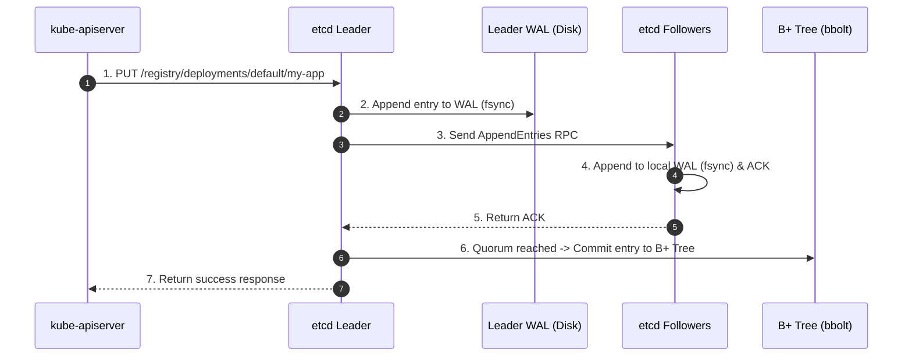

---

## Question
How does etcd store Kubernetes cluster state internally using key-value MVCC (Multi-Version Concurrency Control), and how does the API server handle bbolt database compaction and revision watch streams?

## Quick Answer
**etcd uses the Raft consensus algorithm to replicate a key-value store backed by BoltDB (bbolt) on disk**, where all Kubernetes objects are stored as protobuf-encoded values under versioned keys like `/registry/deployments/default/my-app`.

---


## Detailed Answer
Every Kubernetes object — Pod, Deployment, Secret, ConfigMap — is serialized to **protobuf** (not JSON) and stored as a value in etcd's B+ tree (bbolt). Keys follow the pattern `/registry/<resource>/<namespace>/<name>`. **etcd maintains a global revision counter** that increments on every write, enabling Kubernetes's `resourceVersion` field and watch streams. The Raft protocol guarantees that a write is only acknowledged after a quorum of etcd members (majority) have appended it to their WAL (Write-Ahead Log). The WAL is the source of truth — the bbolt database is a materialized snapshot of the WAL.

---

## Deep Dive
## etcd internal storage layout
```
etcd member disk layout:
/var/lib/etcd/
├── member/
│   ├── wal/               # Write-Ahead Log — durable sequential writes
│   │   ├── 0000000000000000-0000000000000000.wal
│   │   └── 0000000000000001-0000000000000000.wal
│   └── snap/              # Snapshots (compressed bbolt DB state)
│       ├── db             # Latest snapshot
│       └── 0000000000000005-0000000000000000.snap
```

## Inspecting etcd keys directly
```bash
# Exec into etcd pod (or use etcdctl on control plane node)
ETCDCTL_API=3 etcdctl \
  --endpoints=https://127.0.0.1:2379 \
  --cacert=/etc/kubernetes/pki/etcd/ca.crt \
  --cert=/etc/kubernetes/pki/etcd/peer.crt \
  --key=/etc/kubernetes/pki/etcd/peer.key \
  get /registry/deployments/default/my-app \
  --print-value-only | \
  auger decode   # auger decodes protobuf to YAML (github.com/etcd-io/auger)

# List all keys for a resource type
ETCDCTL_API=3 etcdctl \
  --endpoints=https://127.0.0.1:2379 \
  --cacert=/etc/kubernetes/pki/etcd/ca.crt \
  --cert=/etc/kubernetes/pki/etcd/peer.crt \
  --key=/etc/kubernetes/pki/etcd/peer.key \
  get /registry/pods/ --prefix --keys-only | head -20

# Check total etcd DB size
ETCDCTL_API=3 etcdctl \
  --endpoints=https://127.0.0.1:2379 \
  --cacert=/etc/kubernetes/pki/etcd/ca.crt \
  --cert=/etc/kubernetes/pki/etcd/peer.crt \
  --key=/etc/kubernetes/pki/etcd/peer.key \
  endpoint status --write-out=table
```

## Raft write path


## Key etcd data model concepts
| Concept | Description | Kubernetes usage |
|---|---|---|
| Revision | Global monotonic counter | `resourceVersion` on all objects |
| Lease | TTL-based key expiry | Node heartbeats, leader election |
| Watch | Stream of change events from a revision | `kubectl get -w`, informers |
| Compact | Delete old revisions to reclaim space | Run periodically, e.g., every 5 min |
| Defrag | Reclaim fragmented disk space in bbolt | Run during maintenance windows |
| Snapshot | Point-in-time full DB backup | Disaster recovery |

> **Why it matters:** Understanding etcd's internals is essential for diagnosing slow API server responses, watch lag, and disk space issues. Every `kubectl apply` is ultimately a write to etcd.

> **Common mistake:** Assuming etcd stores JSON. It stores **protobuf**. If you `etcdctl get` a key and pipe it to `cat`, you'll see binary garbage. Use `auger decode` or `kubectl get -o yaml` instead.

> **Self-assessment:** Can you explain what happens at the disk level when you run `kubectl apply`? Can you trace a write through Raft from leader to follower? Can you find any object in etcd using `etcdctl`?

> **Follow-up questions:** Q7 (etcd performance tuning), Q8 (etcd monitoring), Q10 (etcd HA topology)

---

<Callout variant="tip" title="Key Takeaways">
- **Bbolt Key-Value Store**: etcd stores Kubernetes resources as serialized Protobuf binaries in a single bbolt B+ tree database file.
- **Revisions & MVCC**: Every write increments a global 64-bit revision; periodic compaction and defragmentation are required to reclaim disk space from historical revisions.
</Callout>

