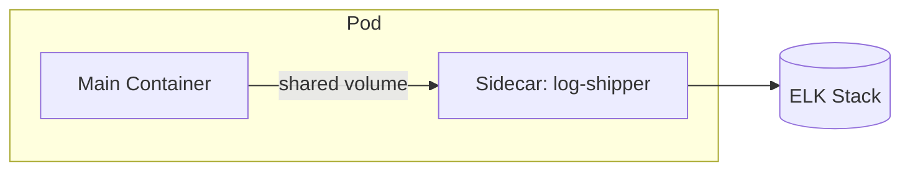

## Question
How do the Sidecar, Ambassador, and Adapter multi-container Pod patterns enhance application functionality, and when should you use each pattern in production?

## Quick Answer
Sidecar extends main container functionality (logging, proxying); Ambassador proxies outbound traffic; Adapter transforms output format — all are multi-container pod patterns sharing the same network and storage.


## Detailed Answer
All three patterns rely on the same underlying fact: **containers in the same pod share a network namespace and can share storage volumes**, so a second container can add capability to the main one without modifying its code at all. They differ only in *what problem* they solve:

| Pattern    | Role                                    | Common Examples                     |
|------------|------------------------------------------|--------------------------------------|
| Sidecar    | Extends or enhances the main container    | Log shipper, secret rotator, Istio proxy |
| Ambassador | Proxy for outbound connections            | DB connection pooler, local proxy to cloud service |
| Adapter    | Transforms the main container's output    | Prometheus exporter, format converter |



## Production Implications
- Use these patterns specifically when you **can't modify the main application's code** but still need to bolt on logging, proxying, or format translation
- Sidecars share fate with the main container — if the sidecar crash-loops, kubelet's default pod restart policy affects the whole pod, not just that one container
- Ambassador containers centralize outbound connection logic (pooling, retries, TLS) so the main app can talk to `localhost` and stay unaware of the real destination
- Adapter containers are the right fix for legacy apps that expose metrics/logs in a non-standard format your monitoring stack can't consume directly

```yaml
# SIDECAR: log shipper reading from a shared volume
spec:
  containers:
    - name: web-app
      image: myapp:v1
      volumeMounts:
        - name: logs
          mountPath: /var/log/app
    - name: log-shipper
      image: fluent/fluent-bit:3.0
      volumeMounts:
        - name: logs
          mountPath: /var/log/app
          readOnly: true
  volumes:
    - name: logs
      emptyDir: {}
```

<Callout variant="tip" title="Key Takeaways">
These patterns solve real coupling problems — reach for them when you can't touch the main application's code but still need to add logging, proxying, or format-translation as a cross-cutting concern.
</Callout>

---
