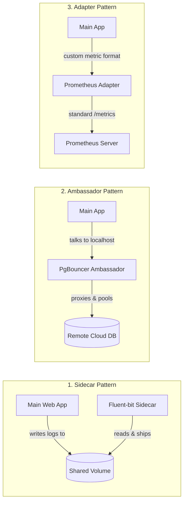

## Question
What are the key architectural differences between Sidecar, Ambassador, and Adapter pod patterns, and how do they extend containerized workloads without modifying primary application code?

## Quick Answer
Sidecar extends main container functionality (logging, proxying); Ambassador proxies outbound traffic; Adapter transforms output format — all are multi-container pod patterns sharing the same network and storage.


## Detailed Answer



| Pattern | Role | Common Examples |
|---|---|---|
| **Sidecar** | Extends or enhances the main container | Log shipper, secret rotator, Istio proxy |
| **Ambassador** | Proxy for outbound connections | DB connection pooler, local proxy to cloud service |
| **Adapter** | Transforms main container output | Prometheus exporter, format converter |

```yaml
# SIDECAR: Log shipping alongside main app
spec:
  containers:
  - name: web-app
    image: myapp:v1
    volumeMounts:
    - name: logs
      mountPath: /var/log/app
  - name: log-shipper              # Sidecar reads logs, ships to ELK
    image: fluent/fluent-bit:3.0
    volumeMounts:
    - name: logs
      mountPath: /var/log/app
      readOnly: true
  volumes:
  - name: logs
    emptyDir: {}

# AMBASSADOR: Local proxy to external DB with connection pooling
spec:
  containers:
  - name: web-app
    image: myapp:v1
    env:
    - name: DB_HOST
      value: "localhost"           # App talks to localhost
    - name: DB_PORT
      value: "5432"
  - name: db-ambassador            # Ambassador proxies to actual DB with pooling
    image: pgbouncer:latest
    env:
    - name: PGBOUNCER_TARGET
      value: "prod-db.us-east-1.rds.amazonaws.com"

# ADAPTER: Expose custom metrics in Prometheus format
spec:
  containers:
  - name: legacy-app
    image: legacy-app:v1           # Exposes metrics in custom format on :9000
  - name: metrics-adapter          # Adapter converts to Prometheus format on :9090
    image: prometheus-adapter:v1
    ports:
    - containerPort: 9090
```


<Callout variant="tip" title="Key Takeaways">
These patterns solve real coupling problems — use them when you can't modify the main application but need to add cross-cutting concerns like logging, metrics, or proxying.
</Callout>

---
