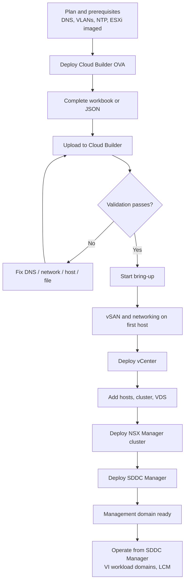

## VCF Deployment Models and Cloud Builder Bootstrapping

→ **Instructor's version warning (read first).** Cloud Builder and the Deployment Parameter Workbook are **VCF 5.x** technology. In **VCF 9.0**, Broadcom replaced Cloud Builder with the **VCF Installer** appliance, and the Excel workbook was removed in favor of a UI wizard or a JSON specification. The current VCP-VCF Administrator exam (2V0-17.25) is scoped to VCF 9.0, so check your exam guide version. This guide teaches the Cloud Builder concepts in full (they are still the foundation, and still appear in real-world estates and older material), then maps each one to its VCF 9 equivalent in [Section 8](#8-vcf-9-what-changed-cloud-builder--vcf-installer). Where an exam answer mentions a Cloud Builder OVA and a workbook, it is describing VCF 5.x.

---

## 1. Learning Objectives

After this module you should be able to:

- Distinguish **consolidated** and **standard** VCF architecture models and the **management domain** vs **VI workload domain** split.
- Describe the role of **Cloud Builder** in **bring-up** (day-0 bootstrapping).
- Explain what is in the **Deployment Parameter Workbook** and the equivalent **JSON spec**.
- List the **pre-check (validation)** categories and troubleshoot common failures.
- Walk through the bring-up workflow in the correct order.
- Map the process to the **VCF Installer** in VCF 9.

---

## 2. VCF Deployment Models

### 2.1 Architecture models

| Model | Description | When to use |
|---|---|---|
| **Standard architecture** | A dedicated **management domain** (vCenter, NSX Manager, SDDC Manager / management components) plus one or more separate **VI workload domains** for tenant workloads | Production, scale, isolation of management from workloads |
| **Consolidated architecture** | Management and user workloads share the **management domain** (workloads run in resource pools) | Small/edge/PoC environments with limited hosts |

### 2.2 Key building blocks

- **Management domain**: the first domain created by bring-up. It hosts the management VMs. It is always created first and cannot be removed.
- **VI workload domain**: created after bring-up (via SDDC Manager in 5.x) for workloads. Has its own vCenter and cluster(s); NSX can be dedicated or shared.
- **Principal storage**: vSAN is the required principal storage for the management domain in classic VCF 5.x bring-up (other principal storage options exist for workload domains).
- **Minimum hosts**: the management domain requires **4 ESXi hosts** for the standard model with vSAN (a commonly tested number).

### 2.3 Deployment "flavors" you should recognize

- **Greenfield**: new hosts imaged to a supported ESXi build, then bring-up.
- **Brownfield / convergence**: reuse an existing vSphere environment (in 5.x via convert/import tooling; in VCF 9 the installer has built-in workflows for this).
- **VCF on VxRail**: uses VxRail Manager for bootstrapping rather than Cloud Builder (a different bring-up path; remember it is *not* Cloud Builder).

---

## 3. Cloud Builder Overview

**Cloud Builder** is a virtual appliance (OVA) that automates **bring-up**: it validates your inputs, then deploys and configures the full management domain.

Key facts:

- Deployed as an **OVA** to a host or vCenter that is **not** part of the management domain being built (for example, a laptop with VMware Workstation/Fusion, or a separate ESXi host). It must have network reachability to the management network of the target hosts and to DNS/NTP.
- OVA deployment parameters include: **admin** and **root** passwords, **hostname**, **IP, subnet, gateway**, **DNS**, **NTP**.
- You access the **Cloud Builder UI** over HTTPS at its FQDN/IP.
- It contains the **bring-up engine** and the **validation framework**.
- It is **temporary** by design: once bring-up succeeds and you no longer need it, it is not part of the running platform (keep it until you are sure you will not need a retry or rebuild).
- Cloud Builder deploys **SDDC Manager**; from that point on, SDDC Manager takes over lifecycle and workload domain operations (5.x).

**Prerequisites before you touch Cloud Builder:**

1. ESXi hosts installed at a **supported build**, with management IP, hostname, root password set.
2. **DNS forward and reverse (A and PTR)** records for *every* component (ESXi hosts, vCenter, NSX Manager nodes and VIP, SDDC Manager, etc.).
3. **NTP** reachable and consistent.
4. **VLANs** and trunking on physical switches for management, vMotion, vSAN, host overlay (TEP) and edge/uplink as required.
5. **MTU**: 9000 end-to-end for vSAN/vMotion/overlay is typical; **1700+ minimum for the NSX overlay (Geneve)**.
6. Free, **unused IP ranges** for management, vMotion, vSAN, and TEP pools.
7. **Licenses** (or evaluation) ready, and storage disks eligible for vSAN (cache + capacity or ESA-eligible).
8. Software **bundles** available as required for your version.

---

## 4. Cloud Builder Parameter Files

Bring-up is driven by a **declarative input**. Cloud Builder accepts either of two formats.

### 4.1 Deployment Parameter Workbook (Excel, `.xlsx`)

A multi-tab spreadsheet you fill in and upload to Cloud Builder. Typical tabs:

| Tab | Purpose |
|---|---|
| **Introduction / Prerequisites** | Checklist of requirements |
| **Credentials** | Passwords for ESXi, vCenter, NSX, SDDC Manager, and other service accounts (must meet complexity rules) |
| **Hosts and Networks** | Management domain network details: VLAN IDs, subnets, gateways, MTU, IP pools for vMotion/vSAN/TEP, ESXi host FQDNs and IPs |
| **Deploy Parameters** | Component names/FQDNs/IPs (vCenter, NSX Manager nodes and VIP, SDDC Manager), DNS and NTP, cluster and datacenter names, vSAN settings, license keys, VDS and port group configuration, optional features (e.g., Aria/vRealize integration in 5.x) |

→ Instructor tip: in the real world, **every wrong cell is a failed validation.** Most bring-up failures I see are typos in FQDNs, missing PTR records, or wrong VLAN IDs.

### 4.2 JSON specification

- The same data in a **machine-readable JSON file**. Easier to version-control, review, and reuse.
- Cloud Builder can accept the JSON directly in the wizard.
- Cloud Builder includes a helper script that converts an Excel workbook to JSON (`/opt/vmware/bringup/scripts/json-generator.sh <workbook.xlsx> <output.json> vcf-ems`).
- A containerized **Configuration File Generator** (a VMware Fling) was also released to validate inputs and generate the JSON without the spreadsheet. It is a community/Fling tool, so know it exists but do not rely on it as an "official" product feature.

### 4.3 Parameter design best practices

- Use a **naming standard** (e.g., `sfo-m01-vc01`, `sfo-m01-nsx01`) because names are hard to change later.
- Pre-create DNS records and test with `nslookup` both directions from the Cloud Builder VM.
- Use **separate, non-overlapping subnets** for management, vMotion, vSAN, and TEP.
- Keep a **password manager entry** for the generated/entered credentials.
- Treat the JSON as an **artifact** of the design: store it with your as-built documentation (but protect the credentials in it).

---

## 5. Pre-Check Validations

After you upload the workbook or JSON, Cloud Builder runs **validation before deployment**. **Bring-up will not start until validation passes** (warnings can be acknowledged; **errors block**). Validation can be re-run after you fix issues.

### 5.1 What gets validated

| Category | What it checks | Typical failure cause |
|---|---|---|
| **Input/Schema** | File format, required fields, value ranges | Missing field, wrong format |
| **ESXi hosts** | Reachability, credentials, **SSH thumbprint**, version/build, no existing config conflicts | Wrong root password, unsupported build, host already configured |
| **DNS** | **Forward and reverse** resolution for all FQDNs | Missing **PTR** record |
| **NTP** | Server reachable, host time in sync | Time drift, firewall |
| **Network** | VLAN IDs, subnet/gateway reachability, **MTU**, IP availability (not already in use), pool sizing | Wrong VLAN tagging, MTU mismatch, IP conflict |
| **Storage (vSAN)** | Disks eligible, adequate cache/capacity | Used disks with old partitions |
| **Licensing** | License keys valid for the product/version | Wrong or expired key |
| **Credentials/Password policy** | Complexity and length rules | Weak password |
| **Compute/Resources** | Enough host capacity to deploy the management VMs | Under-sized hosts |
| **Certificates/Security** | Hostnames match, SSH keys accepted | Mismatched FQDN |

### 5.2 Troubleshooting approach

1. Read the validation result **line by line**; each failed item has a description and often remediation guidance.
2. Fix at the **source** (DNS, switch, host), not just in the file.
3. If you changed the *file*, **re-upload it**.
4. **Re-run validation** until all items are green or accepted warnings.
5. Only then start **bring-up**.

→ **Why this matters:** validation is *cheap*; a failed bring-up halfway through is *expensive*.

---

## 6. Bring-Up Deployment Workflow (Cloud Builder, VCF 5.x)

### 6.1 End-to-end sequence

1. **Plan** and complete prerequisites (DNS, VLANs, NTP, hosts imaged).
2. **Deploy the Cloud Builder OVA** and verify the UI is reachable.
3. **Prepare the parameter file** (workbook or JSON).
4. **Upload** the file in the Cloud Builder wizard.
5. **Run validation** (pre-checks) and resolve all errors.
6. **Start bring-up** (the "Deploy SDDC" action).
7. Cloud Builder **orchestrates**, in broad order:
   - Configures the **first ESXi host(s)** and establishes the **vSAN** datastore and vSphere networking (a **VDS** and port groups).
   - Deploys the **vCenter Server** for the management domain and creates the datacenter and cluster.
   - Adds remaining hosts, configures the **vSAN cluster** and distributed switch(es).
   - Deploys the **NSX Manager cluster** (3 nodes + VIP in standard design), registers it with vCenter, and configures host transport nodes (TEP pools, overlay).
   - Deploys **SDDC Manager** and registers the management domain.
   - Performs final configuration (licensing, certificates/identity as configured).
8. **Monitor** progress in the UI. Bring-up commonly takes **several hours**.
9. On **failure**: read the failed task, fix the root cause, then use **Retry** (it resumes; you generally do not restart from scratch).
10. On **success**: log in to **SDDC Manager** to continue (5.x): download bundles, create **VI workload domains**, configure **NSX Edge** clusters, certificates, backups, and lifecycle management.

### 6.2 Workflow diagram



### 6.3 Common causes of bring-up failure

- DNS records changed after validation
- Host reboots or network flaps during deployment
- Insufficient resources on the first host
- IP conflicts created after validation
- Time drift between components

---

## 7. Exam Tips

1. **Know the version.** Cloud Builder + workbook = **VCF 5.x**. VCF 9 = **VCF Installer** (UI wizard or JSON). Read each question for version clues.
2. **Validation comes before deployment.** If a question asks "what happens when validation fails," the correct answer is that **bring-up cannot proceed** until errors are resolved.
3. **DNS is the #1 culprit.** Forward **and reverse** records are required for all components.
4. **Cloud Builder is not a management component.** It is not deployed into the management domain and is not the long-term management tool.
5. **Management domain first.** It is always the first domain and is created by bring-up.
6. **Know the min host count** (4 for the standard vSAN management domain) and that NSX Manager runs as a **3-node cluster** in standard designs.
7. **Parameter inputs:** workbook (Excel) vs **JSON**: same data, two formats.
8. **After bring-up (5.x), SDDC Manager takes over** for workload domains and lifecycle. In VCF 9, **VCF Operations** is the management console.
9. **Retry, don't restart.** A failed bring-up task is resumed with **Retry** after you fix the cause.
10. **Watch for "distractor" tools:** Aria/vRealize products, SDDC Manager, and VxRail Manager each have a role, but only Cloud Builder (5.x) or the VCF Installer (9) performs **bring-up** for the standard path.

---

## 8. VCF 9: What Changed (Cloud Builder → VCF Installer)

| Topic | VCF 5.x | VCF 9.0 |
|---|---|---|
| Bootstrap appliance | **Cloud Builder** | **VCF Installer** (replaces Cloud Builder) |
| Input | **Deployment Parameter Workbook (.xlsx)** or JSON | **UI wizard** or a reusable **JSON spec** (workbook removed) |
| Software binaries | Bundled in/with Cloud Builder workflow | The Installer appliance does **not** include binaries; they are obtained via download/depot or offline means |
| Scope | Greenfield management domain bring-up | Multiple pathways: deploy a new VCF instance, expand a fleet, and **converge/import an existing vCenter** |
| Validation | Pre-checks before bring-up | **Two-phase gate: validate first, then deploy** (UI can upload, review, and validate the JSON) |
| After deployment | SDDC Manager as primary UI | Link to **VCF Operations** console for management |
| Deployment sizing | Standard/consolidated | **Simple** vs **High Availability** deployment models (fewer vs more appliances) |

**Study hints for VCF 9:**

- Memorize the **concept**: *input spec → validation → deployment → hand-off to management.*
- Understand that the **JSON spec is reusable** and can be generated from the wizard.
- Be able to explain **why** the Installer is more flexible than Cloud Builder (multiple entry points, no spreadsheet, convergence).
- Always verify specifics (appliance counts, supported pathways, binary acquisition) against the **official VCF 9 documentation and the current exam guide**, as these details evolve between releases (e.g., 9.0 vs 9.1).

---

## 9. Practice Questions

### Question 1

An administrator is bootstrapping a new **VCF 5.x** management domain. They uploaded the Deployment Parameter Workbook to Cloud Builder, and validation reports **failures for several FQDNs**. Forward lookups succeed, but the checks still fail. What is the **most likely cause**?

- **A.** The Cloud Builder VM is deployed inside the management domain cluster
- **B.** Reverse (PTR) DNS records are missing for the component FQDNs
- **C.** The ESXi hosts have too much memory
- **D.** The workbook was saved as `.xlsx` rather than JSON

<details>
<summary>Answer and explanation</summary>

**Correct: B.**
Cloud Builder validates **both forward (A) and reverse (PTR)** DNS resolution. A missing PTR record is the classic cause when forward lookups pass but validation still fails.
- **A** is incorrect: Cloud Builder should be outside the management domain being built, but this wouldn't produce FQDN validation errors.
- **C** is irrelevant to DNS checks.
- **D** is incorrect: both `.xlsx` and JSON are accepted.

</details>

### Question 2

Which statement correctly describes the **order** of events in a Cloud Builder bring-up?

- **A.** Bring-up starts immediately after upload; validation runs afterward
- **B.** Validation must pass (or errors be resolved) before bring-up; SDDC Manager is deployed as part of bring-up
- **C.** SDDC Manager is deployed first and then triggers Cloud Builder
- **D.** NSX Manager is deployed on a separate cluster before vCenter exists

<details>
<summary>Answer and explanation</summary>

**Correct: B.**
Cloud Builder enforces **validation before deployment**. During bring-up it deploys vCenter, NSX Manager, and **SDDC Manager** to form the management domain.
- **A** reverses the order.
- **C** is wrong: Cloud Builder is the bootstrap tool, and SDDC Manager is created by it.
- **D** is wrong: vCenter is deployed first and NSX is registered with it; NSX Manager runs in the management domain.

</details>

### Question 3

A candidate is studying with older VCF 5.x notes but sits an exam **scoped to VCF 9.0**. A question asks which component replaces Cloud Builder and how its configuration is supplied. Which answer is correct?

- **A.** SDDC Manager, using a Deployment Parameter Workbook
- **B.** The VCF Installer, using a UI wizard or a JSON specification
- **C.** VxRail Manager, using an XML answer file
- **D.** Cloud Builder is retained in VCF 9 with the workbook unchanged

<details>
<summary>Answer and explanation</summary>

**Correct: B.**
In VCF 9.0 the **VCF Installer** replaces Cloud Builder. Configuration is provided through its **UI wizard** or a reusable **JSON specification**; the Excel workbook is no longer used.
- **A** confuses SDDC Manager (a management component) with the bootstrap tool, and the workbook is removed.
- **C** is incorrect: VxRail Manager is the bring-up tool for VCF on VxRail, not the replacement for Cloud Builder.
- **D** describes VCF 5.x.

</details>

---

## 10. Quick Review Checklist

- [ ] I can explain **consolidated vs standard** architecture.
<details>
<summary>Explanation</summary>
The fundamental difference between **Consolidated** and **Standard** architectures in VMware Cloud Foundation (VCF) comes down to **resource isolation vs. hardware footprint**.

While both architectures deliver the full VCF software-defined stack, they organize where management tools and tenant business applications run.

---

### 1. Consolidated Architecture (Shared Infrastructure)

In a **Consolidated Architecture**, the Management Domain and tenant business workloads are collapsed onto the **same initial ESXi host cluster**.

```text
┌─────────────────────────────────────────────────────────────┐
│                 CONSOLIDATED VCF CLUSTER                    │
│                 (Minimum 4 ESXi Hosts)                      │
├──────────────────────────────┬──────────────────────────────┤
│  MANAGEMENT VMS              │  TENANT WORKLOAD VMS         │
│  • SDDC Manager              │  • Line-of-Business Apps     │
│  • vCenter / NSX Managers    │  • Databases & Microservices │
│  • VCF Operations            │  • Production / Dev Workloads│
├──────────────────────────────┴──────────────────────────────┤
│ Resource Pools (Compute Isolation)                          │
└─────────────────────────────────────────────────────────────┘

```

* **Target Use Case:** Small edge locations, branch offices, proof-of-concept (PoC) labs, or environments with tight hardware budget constraints.
* **Minimum Hosts:** 4 ESXi hosts total.
* **Resource Isolation:** Logical only. vSphere **Resource Pools** and dedicated storage policies separate management control plane appliances from tenant VMs on the same physical hardware.
* **Migration Path:** As the footprint grows, you can convert to a Standard Architecture by provisioning dedicated VI Workload Domains and migrating tenant VMs off the management cluster.

#### Key Trade-Offs

* **Pros:** Lower entry cost, lower power/rack footprint, efficient for smaller deployments.
* **Cons:** Shared physical failure domain (a massive tenant workload issue or host issue can impact control plane resources) and shared operational change windows.

---

### 2. Standard Architecture (Dedicated Infrastructure)

In a **Standard Architecture**, management infrastructure and customer business workloads are physically separated into **dedicated domains**.

```text
┌──────────────────────────────┐    ┌──────────────────────────────┐
│  MANAGEMENT DOMAIN CLUSTER   │    │  VI WORKLOAD DOMAIN CLUSTER  │
│    (Minimum 4 ESXi Hosts)    │    │    (Minimum 3 ESXi Hosts)    │
├──────────────────────────────┤    ├──────────────────────────────┤
│  MANAGEMENT VMS ONLY         │    │  TENANT WORKLOAD VMS ONLY    │
│  • SDDC Manager              │    │  • Customer Applications     │
│  • Mgmt & Workload vCenters  │    │  • Production Databases      │
│  • NSX Manager Clusters      │    │  • Kubernetes / Containers   │
└──────────────────────────────┘    └──────────────────────────────┘

```

* **Target Use Case:** Enterprise data centers, enterprise production clouds, and environments with strict compliance, SLA, or multi-tenancy requirements.
* **Minimum Hosts:** 7 ESXi hosts total (4 for the Management Domain + 3 for the first VI Workload Domain).
* **Resource Isolation:** Physical and logical. Tenant workloads run on dedicated host clusters managed by their own dedicated vCenter instances (which sit inside the Management Domain).

#### Key Advantages

* **Strict Blast Radius Containment:** Tenant applications cannot starve management appliances of memory or CPU resources.
* **Independent Lifecycle Management (LCM):** Patching, updating, or upgrading a VI Workload Domain occurs on its own maintenance schedule without disturbing the Management Domain or other Workload Domains.
* **Flexible Scale:** Clusters can be added or scaled out dynamically based on workload demands (e.g., adding dedicated GPU clusters for AI workloads).

---

### Comparison Matrix

| Architectural Metric | Consolidated Architecture | Standard Architecture |
| --- | --- | --- |
| **Minimum Node Count** | 4 ESXi Hosts | 7 ESXi Hosts (4 Mgmt + 3 Workload) |
| **Workload Location** | Co-located with Mgmt VMs on Cluster 1 | Isolated on dedicated VI Workload Clusters |
| **Isolation Type** | Logical (vSphere Resource Pools) | Physical & Logical (Dedicated hosts/vCenters) |
| **Lifecycle Change Windows** | Shared across management & workloads | Decoupled per domain |
| **Primary Deployment Focus** | Edge sites, smaller sites, budget-constrained | Enterprise production private clouds |

→ **VCF 9 Implementation Note:** In VCF 9, Standard Architecture remains the primary recommended pattern for enterprise clouds. While deploying workloads into the Management Domain is supported for smaller footprints, expanding into dedicated VI Workload Domains provides the cleanest operational experience for day-2 scaling.
</details>
- [ ] I can list what **Cloud Builder** does and where it is deployed.
<details>
<summary>Explanation</summary>
### What Cloud Builder Does

In VCF 5.x and earlier releases, **VMware Cloud Builder** was the automated deployment engine used to bootstrap a new VCF environment. Its core functions included:

1. **Deployment Parameter Validation:**
* Parsed a user-filled deployment specification (historically the VCF Planning and Preparation Excel workbook or JSON parameter file).
* Performed pre-flight validation checks on DNS records, NTP synchronization, IP availability, network pool parameters, and host hardware compatibility.


2. **Automated Infrastructure Bootstrapping:**
* Automatically deployed and configured the virtual machine appliances that make up the initial **VCF Management Domain**.
* Deployed vCenter Server, SDDC Manager, and the NSX Manager cluster onto the initial physical ESXi hosts.


3. **Storage & Networking Configuration:**
* Configured primary shared storage (such as vSAN storage pools or VMFS-on-FC/NFS).
* Configured vSphere Distributed Switches (vDS), VMkernel ports (vMotion, vSAN, Host TEPs), and initial NSX transport node profiles.


4. **Handover to SDDC Manager:**
* Once the Management Domain was fully built and healthy, Cloud Builder transferred platform inventory and management control over to **SDDC Manager** and was powered off or decommissioned.


---

### Where Cloud Builder Is Deployed

* **Deployment Method:** Delivered as a standalone **OVA (Open Virtual Appliance)** virtual machine.
* **Deployment Location:**
* **Temporary Seed Environment:** It was typically deployed on a temporary, standalone ESXi host or an existing vSphere management cluster outside the target VCF environment (or on a local hypervisor using VMware Workstation/Fusion in lab environments).
* **Network Placement:** It required direct network connectivity (L2/L3) to the management network, DNS servers, NTP servers, and the out-of-band management interfaces (iLO/iDRAC) of the fresh ESXi hosts being provisioned.


---

### Critical Shift in VCF 9

In **VCF 9**, Cloud Builder has been **replaced by the VCF Installer appliance**.

* The **VCF Installer** expands upon Cloud Builder's capabilities by replacing the static Excel workbook with a modern wizard UI and JSON input engine.
* Beyond deploying the initial Management Domain, the VCF Installer orchestrates the deployment of **VCF Operations** and **VCF Automation** directly as part of the initial bootstrap workflow.
</details>
- [ ] I can describe the **workbook tabs** and the **JSON** equivalent.
<details>
<summary>Explanation</summary>
### VCF Planning & Preparation Workbook vs. Deployment Specification JSON

Whether deploying legacy VCF (via Cloud Builder) or VCF 9 (via the VCF Installer), the deployment configuration can be supplied via an **Excel Workbook** (used for human planning and GUI import) or a raw **JSON payload** (used for programmatic API execution and automated deployment).

---

### 1. Cloud Builder (VCF 4.x / 5.x)

In Cloud Builder, the configuration file was known as the **Deployment Parameter Sheet** (`.xlsx`) or the **Management Domain JSON Spec** (`.json`).

#### Workbook Tabs (Excel)

* **Instructions / Solution Design:** Overview tab defining deployment type (Standard vs. Consolidated) and platform parameters.
* **Users & Passwords:** Defines universal service passwords, root passwords, and local SSO account credentials across all target components (ESXi, vCenter, NSX, SDDC Manager).
* **Hosts & Networks:** Specifies physical ESXi host FQDNs, out-of-band management IPs (iLO/iDRAC), management IP allocations, vMotion ranges, vSAN ranges, and physical NIC mappings (pNICs).
* **Network Settings:** Defines DNS servers, NTP servers, VLAN IDs, MTU settings, and Gateway IPs for Management, vMotion, vSAN, and TEP networks.
* **Deploy Management Domain:** Defines hostnames, appliance sizes, IP addresses, and VIPs for vCenter Server, SDDC Manager, and the 3-node NSX Manager cluster.

#### JSON Equivalent Structure

The Cloud Builder JSON groups these workbook values into top-level objects:

```json
{
  "sddcSpec": {
    "networkSpecs": [ ... ],
    "managementPoolSpec": { ... },
    "dnsNtpSpec": { ... },
    "vcenterSpec": { ... },
    "nsxtSpec": { ... },
    "sddcManagerSpec": { ... },
    "hostSpecs": [ ... ]
  }
}

```

---

### 2. VCF Installer (VCF 9.x)

In VCF 9, the configuration sheet evolved into the **VCF 9 Planning & Preparation (P&P) Workbook**, and the deployment input is named the **VCF Installer Deployment Spec JSON**.

#### Workbook Tabs (Excel)

* **General / Instance Info:** Defines the Instance Name, Instance Prefix, and domain suffixes.
* **Security & Credentials:** Captures root/admin credentials and allows optional input for **Custom CA Certificates**.
* **Infrastructure Services:** Defines DNS, NTP, and central VCF License Server details.
* **Network Pools & VLANs:** Maps CIDR blocks, gateway IPs, VLAN IDs, and MTU limits for Management, vMotion, vSAN, VM Management, and Host TEP networks.
* **ESXi Host Details:** Inventory table capturing ESXi host FQDNs, management IPs, serial numbers, and physical network adapters.
* **Management Stack Specs:** Sets appliance deployment sizes, FQDNs, and IP allocations for:
* vCenter Server & SDDC Manager
* NSX Manager Cluster & VIP
* VCF Management Services & Fleet Engine (includes runtime platform IPs)
* VCF Operations Cluster (Master, Replica, and Data nodes)
* VCF Automation Cluster (Optional 3-node deployment)


#### JSON Equivalent Structure

Because VCF 9 installs additional platform management services upfront, the VCF Installer JSON schema includes expanded sections for fleet services and operations:

```json
{
  "sddcId": "vcf-instance-01",
  "vcfInstanceName": "Production Private Cloud",
  "dnsNtpSpec": { "dnsServers": ["10.0.0.10"], "ntpServers": ["10.0.0.1"] },
  "securitySpec": {
    "esxiCertsMode": "VMCA",
    "passwords": [ ... ]
  },
  "networkSpecs": [ ... ],
  "hostSpecs": [ ... ],
  "vcenterSpec": { ... },
  "nsxSpec": { ... },
  "vcfManagementServicesSpec": {
    "platformFqdn": "vcf-mgmt.domain.local",
    "ipAddressPool": [ ... ]
  },
  "vcfOperationsSpec": {
    "deploymentSize": "Medium",
    "nodes": [ ... ]
  }
}

```

---

### Key Takeaway & Conversion

1. **Excel Workbook:** Best for site surveys, team planning, and uploading directly into the web UI of Cloud Builder or the VCF Installer.
2. **JSON Spec:** Required when initiating bringup via direct REST API calls (`POST /v1/sddcs`) or through CI/CD pipeline automation.
3. **Conversion:** VCF 9 provides CLI tools and PowerShell modules (such as `VCF.JSONGenerator`) to convert a completed Excel P&P workbook into a valid API deployment JSON automatically.
</details>
- [ ] I can list the **validation categories** and the DNS/NTP/MTU pitfalls.
<details>
<summary>Explanation</summary>
Whether using Cloud Builder or the VCF Installer, pre-flight validation automatically checks the entire deployment specification across several functional categories before touching your host hardware.

---

### VCF Pre-Flight Validation Categories

The automated engine validates configuration parameters across five major areas:

1. **Infrastructure Services:** Verifies network reachability, valid response codes, and clock drift tolerances across configured DNS and NTP servers.
2. **Network Integrity:** Validates IP address uniqueness (checking for existing IP conflicts), gateway reachability, VLAN tag consistency, subnets, and MTU jumbo frame paths across all host interfaces.
3. **Physical Host & Hardware (ESXi):** Connects to host management endpoints to verify ESXi version compatibility, license state, physical NIC (pNIC) speed/duplex links, CPU/RAM thresholds, and clean storage disk availability (unpartitioned, ready for vSAN).
4. **Credential & Security:** Validates SSH access, root/admin credential matches, certificate parameters, and password policy constraints across all target nodes.
5. **DNS Resolution & Reverse Lookup (PTR):** Performs bi-directional lookup tests for every single FQDN defined in the spec (vCenter, SDDC Manager, NSX Managers, ESXi hosts, and VIPs).

---

### Common Pitfalls: DNS, NTP, and MTU

Errors in DNS, NTP, or MTU are responsible for the vast majority of failed deployment attempts.

#### 1. DNS Pitfalls

* **Missing Reverse Lookup (PTR) Records:** Forward resolution (`FQDN → IP`) usually works, but VCF validation strictly fails if reverse resolution (`IP → FQDN`) is missing or mismatched for any component, host, or VIP.
* **Capitalization and Case Sensitivity:** DNS names must be provided in lowercase. Mismatches between upper/lowercase hostnames in DNS vs. the deployment specification can break certificate generation and SSO registration.
* **Transient DNS Latency / Unreachable Upstream Servers:** If the DNS server drops responses under rapid parallel queries during validation, pre-checks fail.

#### 2. NTP Pitfalls

* **Clock Drift Exceeding Limits:** VCF relies on Kerberos, TLS certificates, and distributed database clustering. **Clock drift greater than 60 seconds** between physical ESXi hosts, NTP servers, and deployment appliances will cause instant validation or bootstrap failures.
* **Unreachable External NTP:** Blocking UDP Port 123 at the firewall prevents hosts from syncing time before deployment begins.

#### 3. MTU Pitfalls

* **MTU Mismatch Across the Path:** NSX GENEVE overlay networks require an MTU of **at least 1600 bytes** (1700+ bytes or standard Jumbo Frames of 9000 bytes is recommended). If physical switches or Top-of-Rack (ToR) ports are left at 1500 bytes, TEP-to-TEP validation fails.
* **VLAN MTU Restrictions:** Even if the physical switch ports are set to MTU 9000, any transit router, SVI, or upstream firewalls carrying TEP traffic must also support jumbo frames. Dropped packet fragments break NSX cluster formation.

---

### How to Verify Fixes Before Retrying Bringup

* **Verify DNS (Forward & Reverse):** Run `nslookup <IP>` and `nslookup <FQDN>` from a system on the management subnet for every host and appliance IP. Both must return matching values.
* **Verify NTP Synchronization:** SSH into an ESXi host and run `ntpdate -q <NTP-Server-IP>` or `ntpcli status` to verify time synchronization and offset.
* **Verify MTU / Jumbo Frames:** Run a ping test with the don't-fragment bit set from an ESXi host across the TEP network:
```bash
ping -S 1500 -s 1572 -d <Destination-TEP-IP>

```


*(A successful response confirms that jumbo frames pass unfragmented across the physical network).*
</details>
- [ ] I can recite the **bring-up order**: vSAN/network → vCenter → hosts/cluster → NSX → SDDC Manager.
<details>
<summary>Explanation</summary>
The bring-up order in your query is **slightly out of order** for VCF bootstrapping.

In VMware Cloud Foundation (VCF 4/5 Cloud Builder or VCF 9 Installer), the automated engine cannot deploy vCenter onto a cluster or configure NSX before the physical host networks and storage exist, nor can it finish without deploying SDDC Manager.

---

### The Correct VCF Bring-Up Sequence

1. **1. Host Preparation, Networking & vSAN:** Base physical infrastructure setup.
Bare-metal ESXi hosts are imaged, configured with management IPs, assigned to **VCF Network Pools** (vMotion/vSAN), and their local storage is initialized for **vSAN / Primary Storage**.


2. **2. vCenter Server Deployment:** Compute management plane bootstrap.
The bootstrap engine (Cloud Builder or VCF 9 Installer) deploys the **vCenter Server appliance** directly onto Host 1 to manage the compute inventory.


3. **3. vSphere Cluster Formation:** Resource pooling & vSAN datastore creation.
vCenter aggregates the physical ESXi hosts into the initial **vSphere Cluster**, applies licensing, turns on vSphere HA & DRS, and builds the shared **vSAN Datastore** across all hosts.


4. **4. NSX Manager Cluster Deployment:** Software-defined network control plane.
The engine deploys the **3-node NSX Manager Cluster** on top of the newly formed vSphere cluster, prepares the ESXi hosts as NSX Transport Nodes, and configures Host TEP interfaces for overlay traffic.


5. **5. SDDC Manager & VCF Platform Services:** Orchestration & inventory handover.
The engine deploys **SDDC Manager** (and in VCF 9, VCF Operations / Management Services). SDDC Manager takes ownership of the newly built Management Domain, registers all inventory, and becomes the lifecycle controller.


---

### Quick Memory Rule

To keep it straight, remember: **Physical Infrastructure `→` Compute Control `→` Network Control `→` Platform Management**


→ **Formula:** `Hosts/vSAN/Network  →  vCenter & Cluster  →  NSX  →  SDDC Manager`


</details>
- [ ] I can explain **what changed in VCF 9** (VCF Installer, no workbook, validate-then-deploy).
<details>
<summary>Explanation</summary>
In **VCF 9**, the deployment and bootstrapping engine underwent a massive architectural overhaul. Broadcom retired the legacy Cloud Builder appliance and fundamentally changed how configuration data is collected, validated, and executed.

---

### 1. Cloud Builder Retired `→` Replaced by VCF Installer

* **Old Way (VCF 4/5):** Cloud Builder was a temporary, standalone OVA used exclusively to build the initial Management Domain. Once complete, it handed management off to SDDC Manager and sat dormant or was deleted.
* **VCF 9 Way:** The **VCF Installer** is a modern, unified deployment appliance. Beyond bootstrapping the Management Domain, it coordinates with **VCF Management Services** and deploys **VCF Operations** as part of the initial bringup sequence.

---

### 2. The Shift in Workbook Usage

There is a common misconception that the *Excel Workbook itself* is completely gone. **The workbook still exists for human site surveys and planning, but it is no longer the required import mechanism for bringup.**

| Aspect | Legacy VCF (Cloud Builder) | VCF 9 (VCF Installer) |
| --- | --- | --- |
| **Excel Planning Workbook** | **Mandatory.** Filled out and uploaded directly into Cloud Builder to drive the UI. | **Optional / Reference Only.** Used as the *Planning & Preparation (P&P)* survey sheet. |
| **Primary Deployment Driver** | Excel import or raw JSON file. | **Interactive Web Wizard or JSON Spec.** |
| **State Persistence** | If Cloud Builder failed mid-deployment, you often had to re-upload the workbook and restart. | **Progressive State Saving.** The VCF Installer wizard saves inputs step-by-step in memory. You can pause, adjust, and resume without losing data. |
| **JSON Export** | Requires manual export scripts or API extraction. | **1-Click JSON Spec Download.** You can fill out the wizard UI and download the generated deployment JSON spec directly for future automated deployments. |

---

### 3. The "Validate-Then-Deploy" Engine Workflow

In VCF 9, pre-flight checks are decoupled from execution via a formal two-phase pipeline: **Validate Phase `→` Deploy Phase**.

```text
┌─────────────────────────────────────────────────────────────┐
│                    1. INPUT CONFIGURATION                   │
│         Web Wizard UI   OR   Import Deployment JSON         │
└──────────────────────────────┬──────────────────────────────┘
                               │
                               ▼
┌─────────────────────────────────────────────────────────────┐
│                    2. VALIDATION PHASE                      │
│   • DNS Forward & PTR Check     • NTP Drift Validation      │
│   • IP Conflict Scanning        • ESXi Clean Disk Checks    │
│   • Network Pool / Gateway MTU  • Appliance Depot Check     │
└──────────────────────────────┬──────────────────────────────┘
                               │
                       [Passed Validation]
                               │
                               ▼
┌─────────────────────────────────────────────────────────────┐
│                     3. DEPLOYMENT PHASE                     │
│   Hosts/vSAN ──► vCenter ──► Cluster ──► NSX ──► SDDC Mgmt  │
└─────────────────────────────────────────────────────────────┘

```

#### Key Differences in VCF 9 Validation:

1. **Strict Offline/Online Depot Check:** Before running pre-checks, the VCF Installer validates that software packages (ESXi, vCenter, NSX, VCF Operations) exist in the local offline depot or online depot with valid checksums matching the VCF 9 Bill of Materials (BOM).
2. **Hard Gate Before Execution:** You cannot initiate the deployment sequence until the validation engine returns a 100% **PASS** score across DNS, NTP, IP allocation, MTU jumbo paths, and host storage states.
3. **In-Line Remediation:** If a validation pre-check fails (e.g., a missing DNS PTR record or an IP conflict), the UI highlights the exact failed parameter. You fix the setting in your environment, click **Re-validate**, and proceed without needing to rebuild or re-upload the deployment specification.
</details>

---

*Study Guide 02 of the VCP-VCF Administrator series. Always verify version-specific details against the current official VMware by Broadcom documentation and exam guide before your exam date.*

---

<div className="flex flex-col sm:flex-row items-center justify-between gap-4 py-6 border-t border-border mt-10 not-prose">
  <a href="/certifications/vmware/vcf-administrator/study-notes/vcf-01-architecture-fundamentals" className="w-full sm:w-auto inline-flex items-center gap-2 px-4 py-2.5 rounded-xl border border-border/80 bg-card/60 hover:bg-card hover:border-primary/50 text-sm font-medium transition-colors shadow-sm">
    ← Previous: Module 01: VCF Architecture Fundamentals & BOM Integration
  </a>
  <a href="/certifications/vmware" className="text-xs font-mono text-muted-foreground hover:text-primary transition-colors text-center px-2">
    VCF Administrator Track
  </a>
  <a href="/certifications/vmware/vcf-administrator/study-notes/vcf-03-mgmt-vs-workload-domains" className="w-full sm:w-auto inline-flex items-center justify-end gap-2 px-4 py-2.5 rounded-xl border border-border/80 bg-card/60 hover:bg-card hover:border-primary/50 text-sm font-medium transition-colors text-right shadow-sm">
    Next: Module 03: Management Domain vs Workload Domains →
  </a>
</div>
